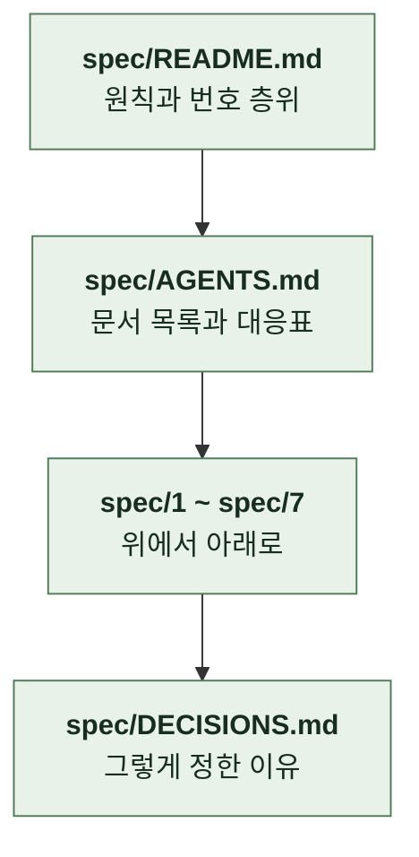

# LinKHU 문서

LinKHU의 현재 동작과 그렇게 정한 이유, 운영 규격을 기록한다.

기억하지 말고 기록한다. 논의와 결정을 문서로 남겨, 다음 작업에서 에이전트가 스펙과 당시 결정을 찾아오면 그 맥락 위에서 다음 결정을 할 수 있게 한다.

## 무엇이 어디 있나

| 폴더 | 담는 것 | 언제 쓰는가 |
|---|---|---|
| [`spec/`](spec/README.md) | 배경, 요구사항, 설계, 계약, 구현 규약, 운영 규격 | 코드를 바꿀 때마다 **함께 갱신한다** |
| [`spec/DECISIONS.md`](spec/DECISIONS.md) | 검토한 선택지와 결정 이유 | 설계 방향을 정하거나 바꿀 때 **덧붙인다** |
| [`copy/`](copy/README.md) | 스토어와 커뮤니티 문구 원본 | 릴리스마다 |
| [`releases/`](releases) | 버전별 릴리스 노트 | 릴리스마다. 낸 뒤에는 고치지 않는다 |

`spec/`이 **현재**이고 `DECISIONS.md`가 **과거**다. 스펙은 코드와 함께 계속 갱신되고, 결정 기록은 쓴 뒤 고치지 않고 뒤에 덧붙인다. 둘이 어긋나면 스펙이 현재다.

**운영 절차도 `spec/` 안에 있다.** 릴리스는 §7-5, 스토어 제출은 §7-6, 서비스 아이콘은 §4-6, 스크린샷은 §4-7, 문의 채널은 §5-3이다. 절차와 그 절차가 지켜야 할 계약이 갈라지면 한쪽만 바뀌므로 별도 가이드 폴더를 두지 않는다.

## 읽는 순서

스펙의 원칙과 층위 규칙은 [`spec/README.md`](spec/README.md)에, 문서 목록과 코드 대응표는 [`spec/AGENTS.md`](spec/AGENTS.md)에, 작업 절차(이슈, 브랜치, 커밋, PR)는 [저장소 `AGENTS.md`](../AGENTS.md)에 있다.

## 문서와 책임

| 문서 | 책임 |
|---|---|
| [스펙](spec/README.md) | 현재 구조와 동작, 층위 번호, 주제별 원본 |
| [스펙 세트 안내](spec/AGENTS.md) | 문서 목록과 상태, 작업별 참조, 코드와 스펙의 대응, 작성 규칙과 점검 |
| [결정 기록](spec/DECISIONS.md) | 검토한 선택지와 결정 이유 |
| [배포 문구](copy/README.md) | 스토어와 커뮤니티 문구의 읽는 순서와 책임 |
| [1-1-STORE-LISTING.md](copy/1-1-STORE-LISTING.md) | 스토어 설명 원본 |
| [1-2-COMMUNITY-POST.md](copy/1-2-COMMUNITY-POST.md) | 커뮤니티 홍보글 원본 |
| [supported-services.md](supported-services.md) | 지원 서비스 목록. 데이터를 바꾸면 같은 PR에서 손으로 갱신한다 |

GitHub Pages 랜딩은 [`landing/`](../landing)에 있다. 이 폴더는 사이트로 배포되지 않는다.

## 변경 원칙

1. 스펙은 코드와 함께 갱신한다. 어느 코드가 어느 문서와 짝인지는 [스펙 세트 안내의 대응표](spec/AGENTS.md#3-명세와-코드의-대응)에 있다.
2. 결정 기록은 쓴 뒤 고치지 않는다. 결정이 바뀌면 새 줄을 덧붙이고 옛 줄의 상태만 바꾼다.
3. 작업 절차는 [저장소 `AGENTS.md`](../AGENTS.md)에 있고 이 문서에서 반복하지 않는다.
