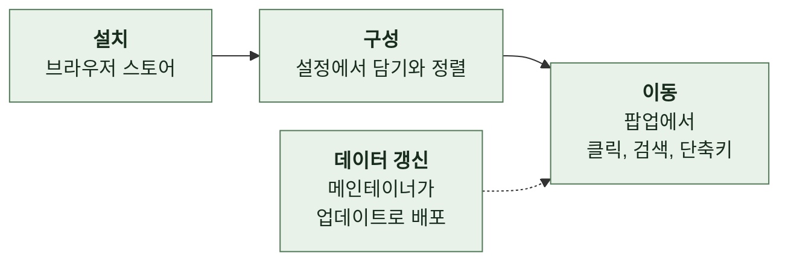

# 1. 배경

이 문서는 LinKHU가 다루는 영역과 서비스 배경, 사용자가 겪는 문제와 LinKHU가 주는 가치, 이용 흐름과 주체, 제품이 하지 않는 일, 문서 전체가 쓰는 용어를 설명한다.

 

### 1-1 도메인

LinKHU는 경희대학교 교내 웹서비스로 가는 바로가기를 다룬다. 서비스마다 도메인과 주소가 다르고, 학교 사이트 개편에 따라 주소가 바뀌기도 한다.

| 갈래 | 예 | 학생이 하는 일 |
| --- | --- | --- |
| 학사와 포털 | 인포21, 수강신청 | 성적, 수강, 학적 처리 |
| 학습 | e-Campus | 강의 자료와 과제 |
| 생활과 정보 | 공지사항, 캠퍼스별 식단, 도서관 | 학교 소식과 생활 정보 확인 |
| 지원 | 장학처, 현장실습 | 신청과 조회 |
| 단과대와 학과 | 단과대 홈페이지, 학과 홈페이지 | 소속 단위의 공지와 일정 확인 |

 

### 1-2 서비스 배경

**1. LinKHU의 포지션**

| 구성 | 내용 |
| --- | --- |
| 제품 | 교내 웹서비스로 한 번에 이동하게 돕는 브라우저 확장 프로그램 |
| 팝업 | 툴바 아이콘을 누르면 열림. 사용자가 골라 둔 바로가기를 격자로 보임 |
| 설정 페이지 | 어떤 서비스를 담고 어떤 순서로 둘지 정함 |
| 랜딩 | GitHub Pages의 소개 페이지. 지원 서비스 검색, 변경 이력, 설치 안내 |

| 북마크, 검색과 다른 점 | 내용 |
| --- | --- |
| 목록 관리 | 지원 서비스 목록은 메인테이너가 관리함. 사용자는 골라 담기만 함 |
| 아이콘 | 서비스마다 한눈에 구분되는 아이콘을 따로 그림 |

 

**2. 타겟**

| 구분 | 사용자 |
| --- | --- |
| 핵심 | 교내 웹서비스를 매일 오가는 경희대학교 학생 |
| 보조 | 학점교류로 경희사이버대 강의를 듣는 학생 |

 

### 1-3 현재 문제와 가치

| 지금 쓰는 방법 | 문제 |
| --- | --- |
| 필요할 때마다 검색 | 서비스마다 주소가 달라 매번 찾음. 학과 홈페이지는 특히 검색해야 찾을 때가 많음 |
| 브라우저 북마크 | 쓰는 사이트가 늘수록 북마크가 끝없이 쌓임 교내 사이트는 같은 학교 아이콘을 쓰는 경우가 많아 서로 구분하기 어려움 주소가 바뀌면 다시 검색해 찾고 북마크를 새로 등록해야 함 |

| 가치 | 내용 |
| --- | --- |
| 탐색 비용 제거 | 학과 홈페이지까지 포함한 목록에서 골라 담아 씀 |
| 한눈에 구분 | 서비스마다 따로 그린 아이콘이라 비슷한 사이트끼리 헷갈리지 않음 |
| 주소 관리 | 주소가 바뀌면 메인테이너가 업데이트로 내보냄. 담아 둔 목록은 그대로이고 바뀐 주소로 열림 |
| 손해 없음 | 메인테이너의 갱신이 늦어도 그동안은 북마크처럼 직접 검색하면 됨 |
| 개인화 | 평소 팝업에는 고른 것만 보이고, 검색할 때만 전체 서비스에서 찾음 |

 

### 1-4 이용 흐름과 주체

| 주체 | 누구인가 | 이 제품에서 하는 일 |
| --- | --- | --- |
| 사용자 | 경희대학교 구성원 | 바로가기를 고르고 정렬함 팝업으로 이동하고 검색함 문의하기로 의견을 보냄 |
| 메인테이너 | 저장소를 관리하는 사람 | 지원 서비스 목록과 아이콘 관리 릴리스와 스토어 제출 문의 대응, 기여 검토 |
| 기여자 | 외부에서 PR을 보내는 사람 | 데이터 수정과 기능 제안 |
| 브라우저 스토어 | Chrome Web Store, Firefox Add-ons, Whale Store | 확장 배포와 자동 업데이트 |
| GitHub | 저장소, Releases, Pages | 소스 관리와 CI, 릴리스 배포, 랜딩 배포, 최신 버전 조회 |
| Google Forms | 문의 수집 폼 | 팝업, 설정, 랜딩의 문의 수집 |
| Google Analytics | 랜딩 분석 | 랜딩 방문과 이용 흐름 집계 |

 

### 1-5 하지 않는 것

표의 항목은 권한이 늘거나 서버가 생기는 일이라 제품 판단으로 다룬다. 시작하기 전에 결정 기록을 남긴다.

| 하지 않는 것 | 의미 | 이유 |
| --- | --- | --- |
| 로그인과 인증 대행 | 사용자를 대신해 로그인하지 않음 | 각 서비스의 인증은 해당 사이트에서 이뤄짐 |
| 교내 데이터 크롤링과 중계 | 공지, 성적, 식단 같은 콘텐츠를 가져오지 않음 | 이동만 시킴 |
| 확장 사용 행동 수집 | 확장에 분석 SDK, 텔레메트리, 원격 로그가 없음 랜딩만 방문과 이용 흐름을 셈. 입력값과 개인 정보는 보내지 않음 | 최소 권한 |
| 계정 기반 동기화 | 설정은 브라우저 로컬 저장소에만 남음 | 서버가 없음 |
| 경희대학교 공식 서비스 지위 | 공식 산출물이 아님 | 공식 색상을 쓰되 대학을 사칭하지 않음 |

 

### 1-6 공통 용어

| 용어 | 의미 |
| --- | --- |
| **서비스** | LinKHU가 바로가기를 제공하는 교내 웹사이트 하나. 지원 서비스 목록의 항목 하나 |
| **식별자** | 서비스마다 붙인 영문 소문자 문자열. 순서 저장과 검색에 씀 |
| **카테고리** | 서비스를 묶는 분류 |
| **내 바로가기** | 사용자가 팝업에 보이려고 직접 고르고 정렬한 서비스들 |
| **기본 목록** | 바로가기 순서를 한 번도 저장하지 않았을 때 팝업이 보이는 서비스들. 카테고리와 별개 |
| **팝업** | 툴바 아이콘을 눌렀을 때 열리는 화면 |
| **설정 페이지** | 탭으로 열리는 확장의 설정 화면 |
| **랜딩** | GitHub Pages로 배포하는 소개 페이지. 화면의 링크 이름은 "홈페이지" |
| **메인테이너** | 저장소를 관리하고 데이터 갱신, 릴리스, 스토어 제출, 문의 대응을 맡는 사람 |
| **디자인 토큰** | 화면의 색, 여백, 반경, 그림자, 글자 크기를 이름 붙여 한곳에 정한 값 |
| **서비스 아이콘** | 서비스 하나를 그린 그림 파일 |
| **UI 아이콘** | 설정, 검색, 테마 전환 같은 화면 기능의 기호 |
