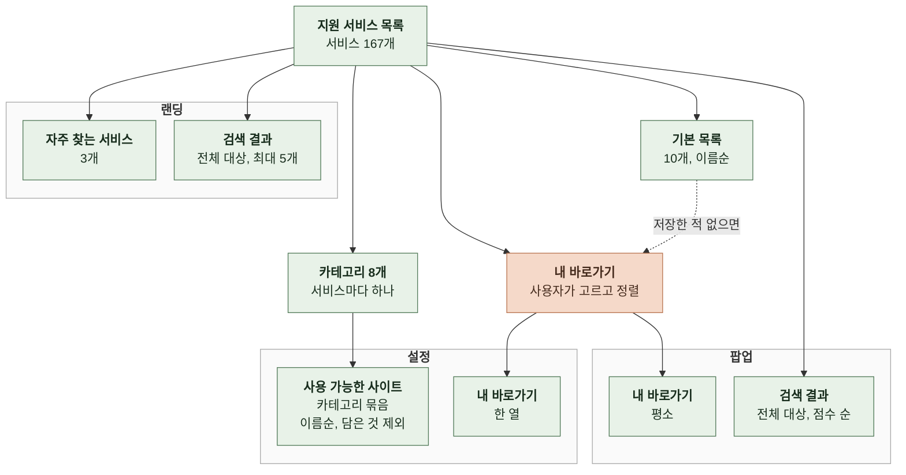

# 3. 정보 구조

이 문서는 제품이 다루는 단위와 카테고리, 화면별 노출 범위, 기본 목록, 검색 대상과 순위를 정한다.

화면 배치는 레이아웃에, 확장과 랜딩의 디자인 성격은 UI 시스템에, 데이터 필드 형식과 중복 규칙은 데이터에 있다. ([4-1 레이아웃](4-1-LAYOUT.md), [4-2-3 확장 우선 원칙](4-2-UI-SYSTEM.md#4-2-3-확장-우선-원칙), [6-2 데이터](6-2-DATA.md))

 

### 3-1 다루는 단위

| 속성 | 쓰이는 곳 |
| --- | --- |
| 이름 | 카드와 목록에 적힘 |
| 아이콘 | 카드와 목록에 보임 |
| 주소 | 눌렀을 때 가는 곳 |
| 카테고리 | 설정 페이지의 묶음과 필터, 랜딩 검색 결과의 보조 줄 |
| 식별자 | 순서 저장과 검색. 확장 화면에는 보이지 않고 랜딩 검색 결과의 보조 줄에 보임 |

| 항목을 만드는 기준 | 내용 |
| --- | --- |
| 단위 | 서비스 하나에 바로가기 하나. 한 사이트의 개별 메뉴나 딥링크는 항목으로 만들지 않음 |
| 예외 | 다른 사이트 안에 있어도 독립된 서비스이면서 자주 찾는 페이지는 항목으로 만듦. 공지사항, 캠퍼스별 식단, h-STEM 융합전공 |
| 중복 | 같은 주소나 같은 이름으로 가는 항목은 두 번 등록하지 않음 |
| 학과 | 독립 홈페이지가 있을 때만 만듦. 독립 서비스 예외는 카테고리가 학과여도 독립 홈페이지 조건에서 제외함 |

 

### 3-2 카테고리

| 카테고리 | 서비스 수 |
| --- | --- |
| 학사·포털 | 13 |
| 생활·복지 | 12 |
| 장학·진로·창업 | 5 |
| 교육·역량 | 16 |
| 캠퍼스·문화 | 11 |
| 대학·행정 | 15 |
| 단과대 | 26 |
| 학과 | 69 |
| **합계** | **167** |

| 규칙 | 내용 |
| --- | --- |
| 계층 | 한 계층. 서비스 하나는 카테고리 하나에만 속함 |
| 순서 | 위 표의 순서가 화면 표시 순서 |
| 서비스 수 | 스펙에서 적는 곳은 위 표 하나 |
| 값 변경 | 계약 변경. 데이터, 카테고리 목록, 검증기 허용 목록, 위 표를 한 PR에서 함께 고침 |

 

### 3-3 화면별 범위

| 화면 | 기본으로 보여주는 것 | 전체 목록 | 분류 노출 |
| --- | --- | --- | --- |
| 팝업 | 내 바로가기 | 검색할 때만 | 없음 |
| 설정 | 전체 서비스 | 항상 | 카테고리 묶음과 필터 |
| 랜딩 | 인포21, e-Campus, 수강신청 | 검색할 때만, 최대 5개 | 결과마다 보조 줄에 카테고리와 식별자 |

 

### 3-4 기본 목록

| 기본 목록 |
| --- |
| 공지사항 |
| 도서관 |
| 수강신청 |
| 에브리타임 |
| 인포21 |
| 장학처 |
| 정보처 |
| 현장실습 |
| ChatKHU |
| e-Campus |

| 규칙 | 내용 |
| --- | --- |
| 표시 순서 | 이름의 `ko-KR` 가나다순. 위 표가 표시 순서임 |
| 지원 서비스 목록에 없는 항목 | 표시하지 않음 |
| 쓰는 때 | 바로가기 순서를 한 번도 저장하지 않은 사용자에게만 표시함. 모두 빼고 저장하면 빈 목록이 저장되고 기본 목록으로 돌아가지 않음 |
| 서비스 추가 | 기본 목록에 자동으로 추가되지 않음 |

 

### 3-5 검색이 다루는 범위

| 항목 | 규칙 |
| --- | --- |
| 대상 | 이름, 식별자, 카테고리. 주소는 대상이 아님 |
| 정규화 | 검색어와 대상 모두 `ko-KR` 소문자로 바꾸고 공백을 모두 지움. "e campus"와 "ecampus"가 같음 |
| 빈 검색어 | 정규화한 검색어가 비면 검색하지 않음 |

| 점수 | 조건 |
| --- | --- |
| 0 | 이름이 검색어로 시작 |
| 1 | 이름에 검색어 포함 |
| 2 | 식별자가 검색어로 시작 |
| 3 | 식별자에 검색어 포함 |
| 4 | 카테고리에 검색어 포함 |
| 없음 | 결과에서 뺌 |
| 동점 | 지원 서비스 목록의 순서 |

| 화면 | 결과 |
| --- | --- |
| 팝업 | 점수가 낮은 순 전체 |
| 랜딩 | 점수가 낮은 순 앞 5개. 팝업과 순위가 같음 |
| 설정 | 순위 없음. 이름, 식별자, 카테고리를 이어 붙여 정규화한 문자열에 검색어가 들어 있으면 보임. 카테고리 묶음 안의 이름순 유지 |
