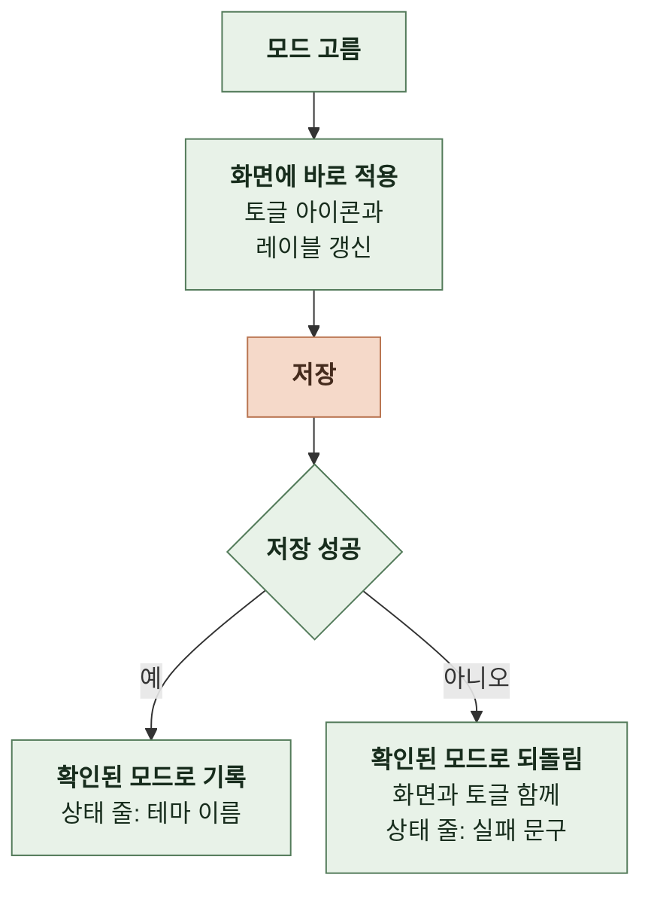

# 4-3 테마

이 문서는 테마 모드 세 가지와 저장 규칙, 선택 UI와 반영 범위, 다크 테마의 구현 방식과 색 토큰 값, 테마별 대비 기준, 랜딩 다크 팔레트를 정한다.

토큰의 사용 위치와 확장과 랜딩이 맞추는 값은 UI 시스템에, 저장 키와 비동기 결과의 순서는 상태에, 초기 적용 순서는 인터랙션에, 저장 실패 시 문구는 오류 처리에 있다. ([4-2-2 디자인 토큰 규칙](4-2-UI-SYSTEM.md#4-2-2-디자인-토큰-규칙), [4-5-1 저장 키 목록](4-5-STATE.md#4-5-1-저장-키-목록), [4-5-4 비동기 결과의 순서](4-5-STATE.md#4-5-4-비동기-결과의-순서), [6-1-5 테마 적용](6-1-INTERACTION.md#6-1-5-테마-적용), [7-1-3 저장소 실패](7-1-ERROR-HANDLING.md#7-1-3-저장소-실패))

 

### 4-3-1 테마 모드

| 모드 | 화면 이름 | 적용하는 테마 |
| --- | --- | --- |
| `system` | 시스템 설정 | 운영체제와 브라우저의 색 구성 선호. 바뀌면 열려 있는 화면에 바로 반영 |
| `light` | 라이트 | 항상 라이트 |
| `dark` | 다크 | 항상 다크 |

기본값은 `system`이다. 저장된 값이 없거나 세 모드에 해당하지 않으면 `system`으로 읽고 저장된 값은 고치지 않는다.

 

### 4-3-2 저장

| 항목 | 확장 | 랜딩 |
| --- | --- | --- |
| 저장소 | 확장 로컬 저장소 | 도메인별 영구 웹 저장소 |
| 읽기 | 결과가 나중에 도착함 | 바로 읽힘 |
| 저장 실패 | 저장이 오류로 끝남, 저장소 없음 | 저장이 오류로 끝남, 저장소 없음 |
| 서로의 값 | 공유하지 않음. 같은 기기에서 확장은 다크, 랜딩은 라이트일 수 있음 | |

| 규칙 | 내용 |
| --- | --- |
| 저장 버튼 | 두지 않음. 고르는 즉시 적용하고 저장함 |
| 되돌릴 기준 | 저장소의 값으로 확인된 마지막 모드. 저장 성공(늦게 도착해도 갱신하되 더 새 성공을 덮지 않음), 초기 읽기, 다른 화면의 저장 알림(내 저장이 진행 중이면 화면은 두고 기준만 갱신)에서 갱신. 초기 읽기 전에는 `system` |

 

### 4-3-3 선택 UI와 반영 범위

| 규칙 | 내용 |
| --- | --- |
| 컨트롤 | 팝업, 설정, 랜딩 모두 헤더의 순환 토글 하나. 레이블 텍스트나 추가 컨트롤을 붙이지 않음 |
| 순환 | `system` → `light` → `dark` → `system` |
| `system` 저장 | 순환이 `system`에 닿으면 해당 모드를 저장함 |
| 아이콘 | 적용된 테마가 아니라 고른 모드를 보임. 시스템 설정은 모니터, 라이트는 해, 다크는 달 |
| 접근성 이름 | 현재 모드와 다음 모드. "테마: {현재}. 누르면 {다음}". 툴팁도 같음 |
| 알림 | 바뀐 결과를 상태 영역으로 알림. 성공 "테마: {모드 이름}"은 스크린 리더만 읽음. 실패 문구는 화면에 보이고 다음 성공 때 사라짐 |
| 알리지 않는 변경 | 다른 화면의 변경, 시스템 테마 변경 |
| 눌림 상태 | 두지 않음. 모드가 세 가지임 |
| 포커스 | 키보드 포커스 표시가 보임 |

 

**1. 동시에 열려 있을 때**

확장의 팝업과 설정은 동시에 떠 있을 수 있다. 랜딩 탭끼리는 동기화하지 않아 다른 탭은 새로고침할 때 바뀐다.

| 규칙 | 내용 |
| --- | --- |
| 구독 | 확장 로컬 저장소의 테마 변경을 구독해 열려 있는 모든 확장 화면의 테마, 아이콘, 레이블을 갱신함 |
| 받은 값 | 정규화한 뒤 적용함 |
| 자기 요청 우선 | 진행 중인 자기 저장이 있으면 외부 값으로 덮지 않음 |
| 갱신 시점 | 토글을 누른 화면은 적용과 동시에 갱신함. 다른 화면은 저장 완료 후 변경 알림을 받아 갱신함 |

 

**2. 초기 적용 시점**

| 화면 | 합격 조건 |
| --- | --- |
| 확장 | 첫 페인트 시점의 문서 루트에 시스템 설정 기준 표식이 있음. 저장된 모드가 다르면 값이 도착할 때 한 번 바꿈 |
| 랜딩 | 저장된 모드를 첫 화면을 그리기 전에 읽어 첫 페인트 시점의 문서 루트에 최종 표식이 있음 |
| 공통 | 문서 파싱이 끝난 뒤에 표식이 붙으면 불합격 |

 

### 4-3-4 구현 방식과 토큰 계약

| 규칙 | 내용 |
| --- | --- |
| 다크 구현 | 토큰 값 교체만. 레이아웃과 컴포넌트를 두 벌 만들지 않음 |
| 어느 테마로 그릴지 | 문서 루트의 표식이 정함. 시스템 색 선호만 보고 다크로 그리지 않음 |
| 표식이 없을 때 | 라이트 |
| 테마에 따라 바꾸지 않는 것 | 레이아웃, 크기, 간격, 문서 구조 |
| 서비스 아이콘 | 반전이나 필터를 걸지 않고 테마별 두 벌을 씀 |
| 브라우저 기본 UI | 테마마다 색 구성을 선언해 스크롤바, 입력의 지우기 버튼, 자리표시 문구가 따라옴 |

 

**1. 주색 계열**

| 토큰 | 라이트 | 다크 | 쓰이는 곳 |
| --- | --- | --- | --- |
| 주색(글자) | `#a40f16` | `#ff4d52` | 로고, 강조 텍스트, 입력 포커스 테두리, 키보드 포커스 윤곽선, 아이콘 버튼 기호, 드래그 중 항목 테두리 |
| 주색 채움 | `#a40f16` | `#c9131c` | 기본 버튼, 배지, 브랜드 패널 배경 |
| 주색 채움 hover | `#790b11` | `#d7141e` | 채움의 hover |
| 주색 진함 | `#790b11` | `#ff7175` | 확장: 쓰지 않음. 랜딩과 값을 맞추려고 둠 랜딩: 검색 데모 입력의 포커스 테두리 |
| 주색 옅음 | `#fdeeef` | `#2a1214` | 단축키 안내 박스, 드래그 중 항목, 아이콘 버튼 hover, 선택된 칩, 드롭 대상의 배경 |
| 주색 테두리 | `#f4bfc3` | `#5c1d20` | 안내 박스 테두리, 카드 hover 테두리, 드롭 대상의 안쪽 윤곽 |
| 주색 링 | `#a40f16` 12% | `#ff4d52` 28% | 입력 요소 포커스 링 |
| 주색 그림자 | `#a40f16` 15% | 검정 45% | 카드 hover 그림자 |
| 주색 위 글자 | `#ffffff` | `#ffffff` | 주색 채움 위의 텍스트 |

 

**2. 중성 계열**

| 토큰 | 라이트 | 다크 | 쓰이는 곳 |
| --- | --- | --- | --- |
| 표면 | `#f8f9fa` | `#0a0a0a` | 팝업 바탕 |
| 올린 표면 | `#ffffff` | `#161616` | 팝업 카드, 설정 화면 바탕, 떠 있는 문의 패널, 목록 항목 |
| 가라앉은 표면 | `#f1f3f5` | `#101010` | 설정 페이지 단 배경 |
| 입력 바탕 | `#ffffff` | `#1c1c1c` | 검색과 문의 입력 요소, 칩의 배경 |
| 텍스트 | `#333333` | `#f4f4f5` | 본문, 항목 이름 |
| 보조 텍스트 | `#666666` | `#a1a1aa` | 보조 설명, 빈 결과 문구, 푸터 링크, 드래그 손잡이, 선택 안 된 칩 글자, 검색과 새 탭 링크 아이콘 |
| 테두리 | `#dddddd` | `#27272a` | 구분선, 카드 기본 테두리, 푸터 구분자, 입력과 칩의 평상시 경계 |
| 진한 테두리 | `#8a8a8a` | `#71717a` | 스크롤바 손잡이, 칩 hover 테두리 |
| 그림자색 | 검정 5% | 검정 45% | 카드와 떠 있는 문의 패널의 그림자 |

 

**3. 기능색**

| 토큰 | 라이트 | 다크 | 쓰이는 곳 |
| --- | --- | --- | --- |
| 알림색 | `#a8321f` | `#ffab91` | 새 버전 안내 링크, 저장 실패 문구 |

 

### 4-3-5 대비 기준

기준은 WCAG 2.1 상대 휘도다. 기준 미달 조합이 하나라도 있으면 병합하지 않는다.

| 대상 | 기준 |
| --- | --- |
| 일반 텍스트 | **4.5:1 이상** |
| 정보를 전달하는 비텍스트. 포커스 표시, 상태 테두리, 컨트롤 경계 | **3:1 이상** |
| 순수 장식. 구분선, 카드 기본 테두리, 입력과 칩의 평상시 경계, 그림자, 주색 테두리. 입력과 칩은 배경색, 자리표시 문구, 글자로 알아볼 수 있음 | 기준 없음 |

 

**1. 실측값**

| 테마 | 글자 또는 요소 | 바탕 | 대비 | 기준 |
| --- | --- | --- | --- | --- |
| 라이트 | 텍스트 `#333333` | 올린 표면 `#ffffff` | 12.63 | 4.5 |
| 라이트 | 텍스트 `#333333` | 가라앉은 표면 `#f1f3f5` | 11.36 | 4.5 |
| 라이트 | 보조 텍스트 `#666666` | 올린 표면 `#ffffff` | 5.74 | 4.5 |
| 라이트 | 보조 텍스트 `#666666` | 표면 `#f8f9fa` | 5.45 | 4.5 |
| 라이트 | 보조 텍스트 `#666666` | 가라앉은 표면 `#f1f3f5` | 5.16 | 4.5 |
| 라이트 | 보조 텍스트 `#666666` | 주색 옅음 `#fdeeef` | 5.10 | 4.5 |
| 라이트 | 주색 `#a40f16` | 올린 표면 `#ffffff` | 7.90 | 4.5 |
| 라이트 | 주색 `#a40f16` | 표면 `#f8f9fa` | 7.49 | 4.5 |
| 라이트 | 주색 `#a40f16` | 주색 옅음 `#fdeeef` | 7.02 | 4.5 |
| 라이트 | 주색 위 글자 `#ffffff` | 주색 채움 `#a40f16` | 7.90 | 4.5 |
| 라이트 | 주색 위 글자 `#ffffff` | 채움 hover `#790b11` | 11.24 | 4.5 |
| 라이트 | 포커스 테두리 `#a40f16` | 입력 바탕 `#ffffff` | 7.90 | 3 |
| 라이트 | 진한 테두리 `#8a8a8a` | 올린 표면 `#ffffff` | 3.45 | 3 |
| 라이트 | 진한 테두리 `#8a8a8a` | 가라앉은 표면 `#f1f3f5` | 3.10 | 3 |
| 다크 | 텍스트 `#f4f4f5` | 표면 `#0a0a0a` | 18.01 | 4.5 |
| 다크 | 텍스트 `#f4f4f5` | 가라앉은 표면 `#101010` | 17.31 | 4.5 |
| 다크 | 텍스트 `#f4f4f5` | 올린 표면 `#161616` | 16.46 | 4.5 |
| 다크 | 텍스트 `#f4f4f5` | 입력 바탕 `#1c1c1c` | 15.50 | 4.5 |
| 다크 | 텍스트 `#f4f4f5` | 주색 옅음 `#2a1214` | 15.99 | 4.5 |
| 다크 | 보조 텍스트 `#a1a1aa` | 표면 `#0a0a0a` | 7.72 | 4.5 |
| 다크 | 보조 텍스트 `#a1a1aa` | 올린 표면 `#161616` | 7.06 | 4.5 |
| 다크 | 주색 `#ff4d52` | 표면 `#0a0a0a` | 6.07 | 4.5 |
| 다크 | 주색 `#ff4d52` | 올린 표면 `#161616` | 5.55 | 4.5 |
| 다크 | 주색 `#ff4d52` | 주색 옅음 `#2a1214` | 5.38 | 4.5 |
| 다크 | 주색 위 글자 `#ffffff` | 주색 채움 `#c9131c` | 5.84 | 4.5 |
| 다크 | 주색 위 글자 `#ffffff` | 채움 hover `#d7141e` | 5.24 | 4.5 |
| 다크 | 포커스 테두리 `#ff4d52` | 입력 바탕 `#1c1c1c` | 5.22 | 3 |
| 다크 | 진한 테두리 `#71717a` | 올린 표면 `#161616` | 3.74 | 3 |
| 다크 | 진한 테두리 `#71717a` | 가라앉은 표면 `#101010` | 3.94 | 3 |
| 다크 | 채움 경계 `#c9131c` | 표면 `#0a0a0a` | 3.39 | 3 |
| 다크 | 채움 경계 `#c9131c` | 올린 표면 `#161616` | 3.10 | 3 |
| 랜딩 라이트 | 채움 패널 안 포커스 `#ffffff` | 주색 채움 `#a40f16` | 7.90 | 3 |
| 랜딩 다크 | 채움 패널 안 포커스 `#ffffff` | 주색 채움 `#c9131c` | 5.84 | 3 |

라이트의 가라앉은 표면 위 진한 테두리(3.10)와 다크의 올린 표면 위 채움 경계(3.10)는 기준선에 가깝다. 관련 토큰을 조정하면 다시 측정해 결과를 PR 본문과 실측값 표에 남긴다.

 

### 4-3-6 랜딩 다크 팔레트

| 토큰 | 라이트 | 다크 | 쓰이는 곳 |
| --- | --- | --- | --- |
| 배경 | `#fafafa` | `#0a0a0a` | 페이지 바탕 |
| 표면 | `#ffffff` | `#161616` | 카드, 대화상자, 푸터 |
| 옅은 표면 | `#f4f4f5` | `#1c1c1c` | 보조 바탕 |
| 글자 | `#1d1d1d` | `#f4f4f5` | 본문 |
| 보조 글자 | `#5f5f5f` | `#a1a1aa` | 보조 설명 |
| 테두리 | `#e4e4e7` | `#27272a` | 카드 윤곽, 구분선 |
| 포커스 | `#2563eb` | `#73a7ff` | 키보드 포커스 윤곽선 |
| 채움 패널 안 포커스 | `#ffffff` | `#ffffff` | 주색 채움 카드 안의 버튼과 링크 윤곽선 |
| 주색 위 보조 글자 | `#f7dee0` | `#f7dee0` | 주색 채움 패널 위의 기능 소개 번호와 본문, 설치 권유 본문 |
| 사용 방법 강조색 | `#ff4d52` | `#ff4d52` | 항상 어두운 사용 방법 구역의 머리말과 단계 번호 |

| 규칙 | 내용 |
| --- | --- |
| 채움 | 버튼, 결과 표시 같은 작은 컨트롤과 기능 소개 강조 카드, 설치 권유 카드가 모두 주색 채움을 씀 |
| 고정 배경 위 글자 | 배경이 테마와 무관한 자리는 테마별로 바뀌지 않는 전용 색을 씀 |
| 뒤집히는 배경 위 글자 | 배경 변화에 맞춰 바뀌는 색을 씀. 스킵 링크는 배경이 글자색이고 글자가 배경색 |
| 다크 장식 | 그림자를 중성으로 바꾸고 히어로 위쪽을 어둡게 덮음. 브라우저 틀과 목록 그림의 바탕을 `#262626`, `#2a2a2a` 계열로 바꿈 |

| 글자 또는 요소 | 바탕 | 대비 | 기준 |
| --- | --- | --- | --- |
| 글자 `#f4f4f5` | 배경 `#0a0a0a` | 18.01 | 4.5 |
| 글자 `#f4f4f5` | 표면 `#161616` | 16.46 | 4.5 |
| 글자 `#f4f4f5` | 옅은 표면 `#1c1c1c` | 15.50 | 4.5 |
| 보조 글자 `#a1a1aa` | 배경 `#0a0a0a` | 7.72 | 4.5 |
| 보조 글자 `#a1a1aa` | 표면 `#161616` | 7.06 | 4.5 |
| 주색 `#ff4d52` | 배경 `#0a0a0a` | 6.07 | 4.5 |
| 주색 `#ff4d52` | 표면 `#161616` | 5.55 | 4.5 |
| 주색 `#ff4d52` | 주색 옅음 `#2a1214` | 5.38 | 4.5 |
| 주색 위 글자 `#ffffff` | 라이트 채움 `#a40f16` | 7.90 | 4.5 |
| 주색 위 글자 `#ffffff` | 다크 채움 `#c9131c` | 5.84 | 4.5 |
| 주색 위 보조 글자 `#f7dee0` | 라이트 채움 `#a40f16` | 6.20 | 4.5 |
| 주색 위 보조 글자 `#f7dee0` | 다크 채움 `#c9131c` | 4.59 | 4.5 |
| 사용 방법 강조색 `#ff4d52` | 사용 방법 바탕 `#1d1d1d` | 5.17 | 4.5 |
| 스킵 링크 글자 `#0a0a0a` | 스킵 링크 바탕 `#f4f4f5` | 18.01 | 4.5 |
| 검색 데모 테두리 `#ff4d52` | 표면 `#161616` | 5.55 | 3 |
| 검색 데모 포커스 테두리 `#ff7175` | 표면 `#161616` | 6.78 | 3 |
| 포커스 윤곽선 `#73a7ff` | 배경 `#0a0a0a` | 8.20 | 3 |
