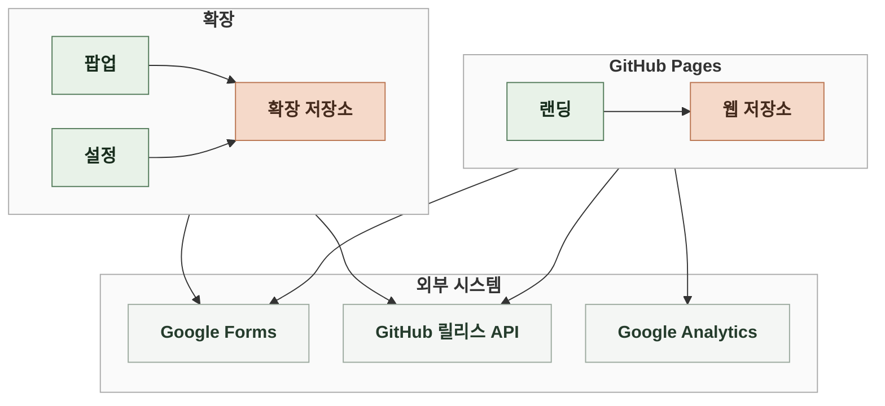
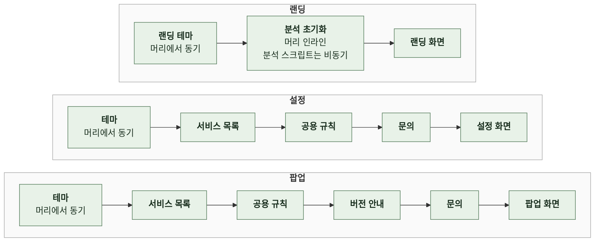

# 4-4 소프트웨어 아키텍처

이 문서는 LinKHU의 개요, 배경과 목표, 품질 속성, 실행 기반, 모듈 구조, 의존 방향을 정한다.

저장 키와 비동기 처리는 상태에, 화면별 처리 순서는 인터랙션에, 바깥과 주고받는 값은 계약에, 검색 순위와 기본 목록은 정보 구조에, 다크 아이콘 경로는 서비스 아이콘에, 카드 이름 줄바꿈은 레이아웃에, 대상 브라우저는 배포에 있다. ([4-5 상태](4-5-STATE.md), [6-1 인터랙션](6-1-INTERACTION.md), [5 계약](5-CONTRACT.md), [3-4 기본 목록](3-INFORMATION-ARCHITECTURE.md#3-4-기본-목록), [3-5 검색이 다루는 범위](3-INFORMATION-ARCHITECTURE.md#3-5-검색이-다루는-범위), [4-6-3 두 벌 체계](4-6-SERVICE-ICON.md#4-6-3-두-벌-체계), [4-1-4 팝업 카드 이름](4-1-LAYOUT.md#4-1-4-팝업-카드-이름), [7-4-1 배포 단위와 대상 브라우저](7-4-DEPLOYMENT.md#7-4-1-배포-단위와-대상-브라우저))

 

### 4-4-1 개요

서버가 없다. 세 화면이 각자 브라우저 안에서 실행되고 필요한 값은 브라우저 저장소와 외부 시스템에서 직접 얻는다.

| 화면 | 실행 환경 | 역할 |
| --- | --- | --- |
| 팝업 | 확장 팝업 | 내 바로가기 표시, 검색, 이동 |
| 설정 | 확장 페이지. 탭으로 열림 | 내 바로가기 선택과 정렬 |
| 랜딩 | GitHub Pages | 제품 소개, 지원 서비스 검색, 변경 이력 |

| 외부 시스템 | 역할 | 연결 방식 |
| --- | --- | --- |
| 확장 로컬 저장소 | 팝업과 설정의 사용자 설정과 버전 캐시 | 확장 로컬 저장소 API |
| 브라우저 웹 저장소 | 랜딩의 테마와 릴리스 캐시 | 영구 저장소, 탭 세션 저장소 |
| GitHub 릴리스 API | 팝업의 최신 버전, 랜딩의 릴리스 목록 | HTTP 요청 |
| Google Forms | 세 화면의 문의 수집 | 응답을 읽지 않는 HTTP 전송 |
| Google Analytics | 랜딩 방문과 이벤트 | 분석 스크립트 비동기 로드 |

| 경계 | 규칙 |
| --- | --- |
| 확장 | 확장 API를 씀. 백그라운드 스크립트와 서비스 워커가 없고 모든 로직은 화면 스크립트 안에 있음 |
| 랜딩 | 일반 웹페이지라 확장 API와 확장 파일을 쓸 수 없음 |

 

### 4-4-2 배경과 목표

| 배경 | 설계 목표 |
| --- | --- |
| 교내 서비스로의 이동만 제공하는 제품 | 서버 없이 브라우저 안에서 끝냄 |
| 설치 시 권한 경고가 크면 교내 정보를 수집한다고 의심받을 수 있음 | 권한은 저장소와 릴리스 조회 주소 하나만 |
| 화면이 세 개뿐인 규모 | 빌드 단계와 의존성 없이 소스가 곧 배포물 |
| 확장과 랜딩은 파일을 공유할 수 없음 | 같아야 하는 규칙은 각자 구현하고 테스트로 결과를 맞춤 |

 

### 4-4-3 품질 속성

| 속성 | 기준 | 보장 방법 |
| --- | --- | --- |
| 최소 권한 | 권한이 저장소와 릴리스 조회 주소 하나뿐 | 탭 권한 없이 탭 열기 API만 씀 |
| 외부 실패 격리 | 버전 조회, 문의 전송, 분석이 실패해도 바로가기 이동은 그대로 | 외부 호출은 화면 그리기를 막지 않고 결과를 기다리지 않음 |
| 첫 페인트 테마 | 테마가 바뀌며 깜빡이지 않음 | 테마 모듈을 문서 머리에서 동기 로드 |
| 결과 순서 | 늦게 도착한 비동기 결과가 최신 화면을 덮지 않음 | 렌더 번호와 요청 번호로 낡은 결과를 버림 |
| 확장과 랜딩의 일치 | 같은 검색어에 같은 결과, 같은 릴리스 노트 | 두 구현의 결과를 비교하는 테스트 |

 

### 4-4-4 실행 기반

**1. 런타임**

| 항목 | 내용 |
| --- | --- |
| 빌드 | 없음. 번들러, 트랜스파일러, 프레임워크를 쓰지 않고 정적 HTML, CSS, JavaScript가 그대로 확장이 됨 |
| 의존성 | 런타임과 개발 모두 없음 |
| Node.js | 개발 도구로만 씀. 검증, 생성, 패키징, 스토어 제출, 테스트 |

 

**2. 매니페스트와 권한**

| 항목 | 값 |
| --- | --- |
| 형식 | Manifest V3 |
| 이름 | `LinKHU` |
| 설명 | 경희대학교 주요 웹서비스 바로가기, LinKHU |
| 권한 | `storage` |
| 호스트 권한 | `https://api.github.com/repos/kangkyunghyun/LinKHU/releases/latest` |
| 탭 권한 | 요청하지 않음. 탭 열기와 현재 탭 이동은 권한 없이 동작함 |
| 팝업 단축키 | 제안값 `Ctrl+Shift+L`, macOS `Command+Shift+L`. 설명 "LinKHU 열기" |
| 설정 페이지 | 확장 설정 페이지로 등록하고 탭에서 엶 |
| 확장 아이콘 | 16, 48, 128px |

 

### 4-4-5 모듈 구조

빌드 단계가 없으므로 각 페이지가 스크립트를 정해진 순서로 불러오고 페이지 전역 이름으로 연결한다. 테마 모듈만 문서 머리에서 동기 로드하고 나머지는 본문 뒤에서 로드한다.

| 모듈 | 책임 |
| --- | --- |
| 테마 | 확장 테마 모드 해석, 저장, 적용, 토글 연결, 적용된 테마 변경 구독 |
| 서비스 목록 | 지원 서비스 목록과 카테고리 목록 |
| 공용 규칙 | 팝업과 설정이 함께 쓰는 규칙. 데이터 검증과 테스트도 불러 씀 |
| 버전 안내 | 현재 버전 표시, 최신 릴리스 비교, 업데이트 링크 |
| 문의 | 문의 폼 전송과 화면 연결 |
| 팝업 화면 | 렌더, 키 입력, 이동, 단축키 안내 |
| 설정 화면 | 목록, 검색과 필터, 드래그, 저장, 단축키 안내 |
| 랜딩 테마 | 랜딩 테마 모드 해석, 저장, 적용, 아이콘 경로 교체 |
| 분석 초기화 | 분석 이벤트 대기열, 스토어 링크 클릭 이벤트 |
| 랜딩 화면 | 랜딩 검색, 변경 이력, 문의, 휴대폰 설치 안내 |

| 공용 규칙 | 쓰는 곳 |
| --- | --- |
| 검색어 정규화 | 팝업, 설정 |
| 검색 점수와 정렬 | 팝업 |
| 기본 목록과 순서 | 팝업, 설정 |
| 테마별 서비스 아이콘 경로와 교체 | 팝업, 설정 |
| 카드 이름 줄바꿈 표와 예외 목록 | 팝업, 데이터 검증 |
| 화면 단축키 판정 | 팝업, 설정 |

 

### 4-4-6 의존 방향

| 방향 | 규칙 |
| --- | --- |
| 화면 → 공용 모듈 | 의존 대상은 항상 먼저 로드됨. 공용 모듈은 화면을 참조하지 않음 |
| 모듈 사이 | 페이지 전역 이름이 겹치지 않음 |
| 공용 모듈 → Node | 공용 모듈은 Node 테스트와 데이터 검증에서도 불러 쓸 수 있게 내보냄 |
| 화면 → 문의 | 팝업과 설정의 문의 폼은 같은 구조를 쓰고 문의 모듈이 한 번 연결함 |
| 확장 ↔ 랜딩 | 코드를 공유하지 않음. 아래 규칙은 양쪽이 각자 구현하되 한쪽을 바꾸면 같은 PR에서 다른 쪽도 바꿈 |

| 같아야 하는 규칙 | 확장 쪽 | 랜딩 쪽 | 결과 비교 테스트 |
| --- | --- | --- | --- |
| 검색 정규화와 순위 | 공용 규칙 | 랜딩 화면 | 있음 |
| 릴리스 노트의 `### Internal` 제거 | Firefox 제출 | 랜딩 화면 | 있음 |
| 문의 전송 폼과 필드, 유형 값 | 문의 | 랜딩 화면 | 있음 |
| 테마별 서비스 아이콘 경로 | 공용 규칙 | 랜딩 테마 | 없음. 각 구현을 따로 테스트함 |
| 테마 모드 해석, 순환, 토글 레이블, 저장 실패 문구 | 테마 | 랜딩 테마 | 없음. 각 구현을 따로 테스트함 |
