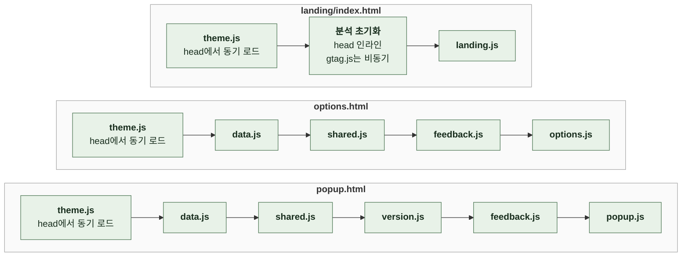

# 4-4. 소프트웨어 아키텍처

이 문서는 세 화면의 경계, 빌드 없이 스크립트를 잇는 방식과 전역 이름, 공용 규칙 파일이 맡는 범위를 정한다.

저장 키와 비동기 처리는 상태에, 화면별 처리 순서와 단축키 판정은 인터랙션에, 검색 순위와 기본 목록은 정보 구조에, 다크 아이콘 경로는 서비스 아이콘에, 카드 이름 줄바꿈은 레이아웃에 있다. ([4-5 상태](4-5-STATE.md), [6-1 인터랙션](6-1-INTERACTION.md), [3-4 기본 목록](3-INFORMATION-ARCHITECTURE.md#3-4-기본-목록), [3-5 검색이 다루는 범위](3-INFORMATION-ARCHITECTURE.md#3-5-검색이-다루는-범위), [4-6-3 두 벌 체계](4-6-SERVICE-ICON.md#4-6-3-두-벌-체계), [4-1-4 팝업 카드 이름](4-1-LAYOUT.md#4-1-4-팝업-카드-이름))

빌드 단계가 없으므로 모듈 그래프 대신 HTML의 스크립트 로드 순서와 전역 객체로 파일을 잇는다. 이 특성을 모르고 파일을 옮기거나 `import`를 도입하면 화면이 깨진다.

 

## 4-4-1 세 화면

| 화면 | 진입점 | 실행 환경 | 역할 |
| --- | --- | --- | --- |
| 팝업 | `src/popup.html` | 확장 팝업 | 내 바로가기 표시, 검색, 이동 |
| 설정 | `src/options.html` | 확장 페이지. 탭으로 열림 | 내 바로가기 선택과 정렬 |
| 랜딩 | `landing/index.html` | GitHub Pages | 제품 소개, 지원 서비스 검색, 변경 이력 |

팝업과 설정은 확장 환경에서 실행되므로 `chrome.*` API를 쓴다. 랜딩은 일반 웹페이지라 `chrome.*`를 쓸 수 없고 확장의 파일도 참조할 수 없다. 백그라운드 스크립트나 서비스 워커는 없고 모든 로직은 화면 스크립트 안에 있다.

확장과 저장소의 Node 스크립트는 랜딩과 코드를 공유할 수 없다. 그래서 두 곳이 같아야 하는 규칙은 각자 구현한다.

| 같아야 하는 규칙 | 저장소 쪽 | 랜딩 쪽 | 결과 비교 테스트 |
| --- | --- | --- | --- |
| 검색 정규화와 순위 | 공용 규칙 파일 | 랜딩 스크립트 | 있음 |
| 릴리스 노트의 `### Internal` 제거 | Firefox 제출 스크립트 | 랜딩 스크립트 | 있음 |
| 문의 전송 폼과 필드, 유형 값 | 문의 스크립트 | 랜딩 스크립트 | 있음 |
| 테마별 서비스 아이콘 경로 | 공용 규칙 파일 | 랜딩 테마 스크립트 | 없음. 쪽마다 따로 테스트함 |
| 테마 모드 해석, 순환, 토글 레이블, 저장 실패 문구 | 확장 테마 스크립트 | 랜딩 테마 스크립트 | 없음. 쪽마다 따로 테스트함 |

한쪽 규칙을 바꾸면 같은 PR에서 다른 쪽도 바꾼다.

 

## 4-4-2 스크립트 결합 방식

외부 스크립트 파일 중에서는 테마 스크립트만 `<head>`에서 동기 로드한다. 테마 표식을 첫 페인트 전에 붙여야 하기 때문이다. 나머지 파일은 본문 뒤에서 그림의 순서대로 로드하며, 의존 대상은 항상 자신보다 먼저 로드된다.

| 파일 | 노출하는 전역 | 책임 |
| --- | --- | --- |
| `src/theme.js` | `ThemeManager` | 확장 테마 모드 해석, 저장, 적용, 토글 연결 |
| `src/data.js` | `MASTER_SITE_LIST`, `SITE_CATEGORIES` | 지원 서비스 목록과 카테고리 목록 |
| `src/shared.js` | `LinKHUShared` | 공용 규칙 |
| `src/version.js` | `VersionManager` | 현재 버전 표시, 최신 릴리스 비교, 스토어 링크 |
| `src/feedback.js` | `Feedback` | 문의 폼 전송과 화면 연결 |
| `src/popup.js` | `App`, `initShortcutNotice` | 팝업 진입점. 테스트가 두 이름을 꺼내 쓴다 |
| `src/options.js` | `SiteFilter`, `OptionsStorage` | 설정 진입점. 테스트가 두 이름을 꺼내 쓴다 |
| `landing/theme.js` | `LandingTheme` | 랜딩 테마 모드 해석, 저장, 적용 |
| 랜딩 head 인라인 스크립트 | `gtag`, `dataLayer` | 분석 이벤트 대기열, 스토어 링크 클릭 이벤트 |
| `landing/landing.js` | 없음 | 랜딩 검색, 변경 이력, 문의, 휴대폰 설치 안내 |

| 규칙 | 이유 |
| --- | --- |
| ES 모듈이 아닌 classic script로 불러온다 | 데이터 검증기와 테스트가 소스 파일을 격리된 환경에서 평가해 전역을 꺼내 쓴다 |
| 파일의 최상위 이름은 같은 페이지의 모든 스크립트가 함께 쓰므로 겹치지 않게 한다 | 뒤에 로드한 파일이 같은 이름을 다시 선언하면 그 파일 전체가 실행되지 않는다 |
| 공용 파일은 끝에서 `module`이 있을 때만 내보낸다 | 브라우저에서는 전역으로 쓰고 Node 테스트에서는 `require`로 불러온다. 새 공용 파일도 같은 방식이다 |
| 팝업과 설정의 문의 폼은 같은 요소 id를 쓰고, 문의 스크립트가 문서 로드 후 한 번 연결한다 | 각 화면이 문의 폼을 따로 구현하지 않는다 |

 

## 4-4-3 공용 규칙

`src/shared.js`에는 팝업과 설정이 함께 쓰는 규칙과, 데이터 검증기와 Node 테스트가 읽어야 하는 팝업 규칙을 둔다. 규칙의 내용은 각 원본 문서에 있다.

| 공용 규칙 | 쓰는 곳 |
| --- | --- |
| 검색어 정규화 | 팝업, 설정 |
| 검색 점수와 정렬 | 팝업. 테스트가 랜딩과 결과를 비교함 |
| 기본 목록과 순서 | 팝업, 설정 |
| 테마별 서비스 아이콘 경로와 교체 | 팝업, 설정 |
| 카드 이름 줄바꿈 표 | 팝업, 데이터 검증기 |
| 줄바꿈 예외 목록 | 데이터 검증기 |
| 화면 단축키 판정 | 팝업, 설정 |
