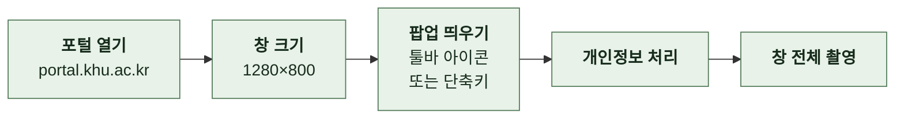

# 4-7 스크린샷

이 문서는 랜딩, README 두 개, 스토어 등록 정보가 함께 쓰는 스크린샷 세 장의 규격과 촬영 방식, 포털 화면을 찍을 때의 개인정보 처리, 촬영 후 확인 항목을 정한다.

스토어 등록 정보에 스크린샷을 올리는 절차는 스토어 제출에 있다. ([7-6 스토어 제출](7-6-STORE.md))

 

### 4-7-1 규격

| 스크린샷 | 크기 | 배율 | 내용 |
| --- | --- | --- | --- |
| 팝업 | 640×894 | 2배. 표시 320×447 | 팝업만 |
| 설정 | 1280×800 | 1배 | 설정 페이지 |
| 히어로 | 1280×800 | 1배 | 포털에서 팝업을 연 브라우저 창 |

| 규칙 | 내용 |
| --- | --- |
| 파일 | 세 장 모두 랜딩 자산에 두고 이름을 바꾸지 않음. 랜딩과 README가 경로를 직접 가리킴 |
| 팝업 배율 | 랜딩에서 폭의 31%(700px 이하 38%)로 작게 표시하므로 2배로 촬영함 |
| 랜딩의 이미지 크기 속성 | 표시 기준 1배 치수. 팝업은 320×447 |
| 테마 | 라이트 |
| 검색창 | 비운 상태 |

 

### 4-7-2 촬영 방식

| 스크린샷 | 촬영 방식 | 브라우저 UI |
| --- | --- | --- |
| 히어로 | 실제 툴바 팝업을 열고 브라우저 창을 찍음. 팝업을 따로 찍어 합성하지 않음 | 포함 |
| 팝업, 설정 | 확장을 로드한 뒤 확장 페이지 주소 `chrome-extension://<확장 ID>/<페이지>`를 직접 열어 찍음 | 없음 |

 

### 4-7-3 팝업

| 항목 | 값 |
| --- | --- |
| 뷰포트 | **320×447**, 기기 배율 2 |
| 내 바로가기 | 설정에서 아홉 개를 이 순서로 저장함. 인포21, e-Campus, 에브리타임, SW중심대학사업단, 소프트웨어 융합대학, 컴퓨터공학부, 현장실습, 수강신청, ChatKHU |
| 보이는 범위 | 카드 아홉 개가 3×3을 채우며 위의 검색창과 아래 "홈페이지 · 문의하기"까지 잘리지 않음 |
| 세로 447px | 위 구성에서의 자연 높이. 팝업 요소가 늘거나 줄면 다시 재고 랜딩의 높이 속성도 고침 |

 

### 4-7-4 설정

| 항목 | 값 |
| --- | --- |
| 뷰포트 | **1280×800**, 1배 |
| 왼쪽 목록 | 2열, 왼쪽:오른쪽 2:1 |
| 보이는 범위 | "사용 가능한 사이트"와 "내 바로가기"가 모두 보이고 "변경사항 저장하기" 버튼까지 들어감 |
| 스크롤 | 맨 위 |

 

### 4-7-5 히어로

 

### 4-7-6 개인정보 처리

포털은 로그인 상태로 찍으면 이름, 학번, 사진, 장학과 메시지 내역이 보인다. 텍스트를 지우면 포털이 비동기로 다시 그릴 때 텍스트가 복원되므로 아래 순서로 처리한다.

| 순서 | 할 일 | 확인 |
| --- | --- | --- |
| 1 | 아래 영역을 스타일로 보이지 않게 함. 지우지 않으므로 레이아웃이 유지됨 | |
| 2 | 스크립트를 멈춤. 개발자 도구에서 일시 정지하거나 자동화 도구로 스크립트 실행을 끔 | 화면을 다시 그려도 숨긴 요소가 나타나지 않음 |
| 3 | 스크립트가 멈춘 상태에서 촬영함 | |
| 4 | 화면에 보이는 텍스트를 훑음 | 개인정보 없음 |
| 5 | 아래 확인 영역 네 곳을 2배로 잘라 다시 봄 | 작은 글씨까지 확인 |

| 숨길 영역 | 포털 선택자 |
| --- | --- |
| 학생 정보 | `.stu_info_w` |
| 이름 줄 | `li.name.bar_line`, `p.name` |
| 사용자 상자 | `.main_user_w`, `.main_user_box` |
| 소속 정보 | `.comInfo` |
| 사용자 문구 | `.user_text01`, `.user_text02`, `.user_text03` |
| 사진 | 주소에 `userPhoto.do`가 든 이미지 |
| 장학 조회 패널 본문 | 클래스에 `1003`이 든 포틀릿의 본문 |
| 메시지(PUSH) 패널 본문 | 클래스에 `1018`이 든 포틀릿의 본문 |

| 확인 영역 | 보는 것 |
| --- | --- |
| 위쪽 브라우저 영역 | 탭 제목, 주소창, 프로필 이름 |
| 왼쪽 사용자 영역 | 이름, 사진, 학과, 학번이 가려졌는지 |
| 팝업에 가린 뒤쪽 | 장학금 금액이 새어 나오는지 |
| 포털 오른쪽 위 | 이름이 붙는 자리인지 |

| 판정 | 기준 |
| --- | --- |
| 올리지 않음 | 이름, 학번, 사진, 학과, 장학금 금액 중 하나라도 보임. 또는 확신이 없음 |
| 남겨도 됨 | 알림 건수, 지급일처럼 개인을 특정하지 않는 값 |

 

### 4-7-7 촬영 후 확인

| 확인 | 기준 |
| --- | --- |
| 픽셀 크기 | 세 장이 규격 표와 같음 |
| 빌드 | 통과 |
| 랜딩 | 로컬 HTTP 서버로 열어 라이트와 다크 모두에서 레이아웃이 깨지지 않음. 팝업 틀 높이는 이미지 종횡비를 따름 |
| README | 두 이미지 표가 깨지지 않음 |
