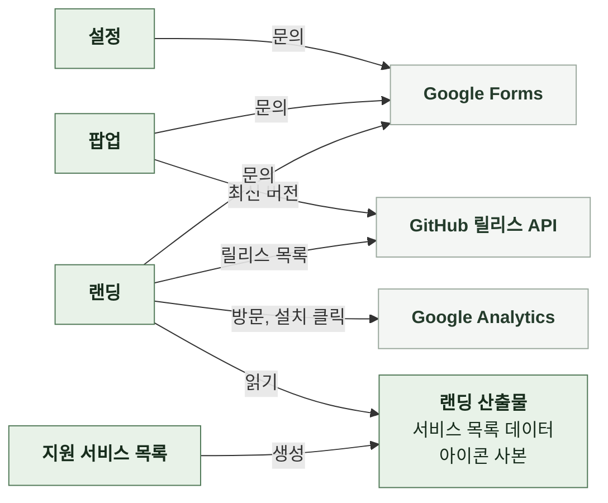

# 5. 계약

이 문서는 LinKHU가 랜딩 산출물, GitHub 릴리스 API, Google Forms, Google Analytics와 주고받는 값의 계약을 정한다.

실패했을 때의 화면 동작과 문구는 오류 처리에, 데이터 스키마와 생성의 동작은 데이터에, 랜딩 배포는 배포에, 저장 키는 상태에, 문의 폼 점검 절차는 테스트 케이스에 있다. ([7-1 오류 처리](7-1-ERROR-HANDLING.md), [6-2-1 스키마](6-2-DATA.md#6-2-1-스키마), [6-2-4 검증 파이프라인](6-2-DATA.md#6-2-4-검증-파이프라인), [7-4-5 랜딩 적용과 복구](7-4-DEPLOYMENT.md#7-4-5-랜딩-적용과-복구), [4-5-1 저장 키 목록](4-5-STATE.md#4-5-1-저장-키-목록), [7-2-5 특별 검증 절차](7-2-TEST-CASES.md#7-2-5-특별-검증-절차))

 

### 5-1 연동 대상과 방식

서버가 없으므로 자체 API는 없다.

| 대상 | 부르는 곳 | 방식 | 성공 | 실패 |
| --- | --- | --- | --- | --- |
| 랜딩 산출물 | 랜딩 | 같은 사이트의 서비스 목록 데이터를 `GET` | 200 서비스 배열 | HTTP 오류, 네트워크 오류 |
| GitHub 최신 릴리스 | 팝업 | `GET .../releases/latest` | 200 `tag_name` | HTTP 오류, 네트워크 오류 |
| GitHub 릴리스 목록 | 랜딩 | `GET .../releases` | 200 릴리스 배열 | HTTP 오류, 네트워크 오류, 배열이 아닌 응답 |
| Google Forms | 팝업, 설정, 랜딩 | `POST formResponse`, `no-cors` | 네트워크 오류 없이 끝남. 응답은 읽을 수 없음 | 네트워크 오류 |
| Google Analytics | 랜딩 | 분석 스크립트 비동기 로드 | 확인하지 않음 | 스크립트를 불러오지 못함 |

 

### 5-2 랜딩 파생 산출물

랜딩은 확장의 파일을 읽을 수 없어 지원 서비스 목록에서 생성한 산출물을 같은 사이트에서 받는다. 두 산출물은 생성물이라 직접 고치지 않는다.

| 산출물 | 내용 |
| --- | --- |
| 서비스 목록 데이터 | 서비스마다 식별자, 이름, 주소, 카테고리, 아이콘 경로 다섯 필드를 이 순서로 담은 JSON 배열. 지원 서비스 목록과 같은 순서. 들여쓰기 2칸, 끝에 개행 |
| 아이콘 사본 | 서비스가 쓰는 라이트 아이콘과 그 다크 짝. 확장과 같은 하위 구조 |

 

### 5-3 GitHub 릴리스 API

| 항목 | 팝업 | 랜딩 |
| --- | --- | --- |
| 주소 | `https://api.github.com/repos/kangkyunghyun/LinKHU/releases/latest` | `https://api.github.com/repos/kangkyunghyun/LinKHU/releases` |
| 요청 머리 | 없음 | `Accept: application/vnd.github+json` |
| 목적 | 최신 릴리스 버전 조회 | 최근 릴리스 변경 이력 표시 |
| 인증 | 없음 | 없음 |
| 캐시 | 확장 저장소에 12시간 | 성공한 응답을 탭 세션 저장소에 탭을 닫을 때까지 |

| 필드 | 팝업 | 랜딩 | 없으면 |
| --- | --- | --- | --- |
| `tag_name` | 앞의 `v`를 떼고 매니페스트 버전과 비교 | 릴리스 제목 | 팝업은 비교를 건너뜀 랜딩은 `name`으로 대신함 |
| `name` | 읽지 않음 | `tag_name`이 없을 때 제목 | 빈 제목 |
| `published_at` | 읽지 않음 | 릴리스 날짜. 방문자 지역 시간 기준 `YYYY. M. D.` | 문자열이 아니거나 날짜로 읽히지 않으면 날짜를 빼고 보임 |
| `draft` | 읽지 않음 | 참값이면 제외 | 게시된 릴리스로 봄 |
| `body` | 읽지 않음 | 변경 내용 | 빈 본문 |

| 규칙 | 내용 |
| --- | --- |
| 호출 한도 | 비인증 한도는 IP 기준 60회/시간. 학내망은 IP를 공유하므로 두 쪽 모두 캐시함 |
| 랜딩 표시 수 | 게시된 릴리스 중 최근 5개. 가장 최근 1개만 펼침 |
| 본문 신뢰 | HTML로 해석하지 않고 요소를 만들어 글자로만 넣음 |
| `### Internal` | 그 줄부터 다음 `### ` 제목 전까지 그리지 않음. 마지막 절이 아니어도 뒤 절은 남음 |
| 본문 표기 | 아래 셋만 표기로 그림. 마크다운 파서를 넣지 않음 |

| 본문 줄 | 그리는 방법 |
| --- | --- |
| `### 제목` | 소제목 |
| `- 항목` | 목록 항목. 이어지는 항목은 한 목록으로 묶음 |
| 빈 줄 | 버림 |
| 그 밖의 줄 | 줄마다 문단 |
| 목록과 문단 안의 `` `코드` `` | 코드 글꼴. 짝이 맞지 않는 마지막 백틱은 글자로 남김. 제목 안의 백틱은 글자로 남김 |

 

### 5-4 Google Forms

| 항목 | 값 |
| --- | --- |
| 주소 | `https://docs.google.com/forms/d/e/1FAIpQLSei30Rr122YHmLlixTDEaWtUPY_pM-EQ20kBMLvyu-52Q6IZQ/formResponse` |
| 부르는 곳 | 팝업, 설정, 랜딩. 세 곳이 같은 주소, 필드, 유형 값을 씀 |
| 전송 방식 | `POST`, `no-cors`, URL 인코딩 본문 |
| 성공 판정 | 네트워크 오류가 없으면 전송된 것으로 봄. CORS 응답 헤더가 없어 응답을 읽을 수 없음 |
| 공개 | 주소와 필드 id는 소스에 그대로 둠. 남이 할 수 있는 일은 폼에 응답을 넣는 것뿐 |

| 필드 | 내용 | 싣는 조건 |
| --- | --- | --- |
| `entry.1096769292` | 문의 본문. 앞뒤 공백을 뺀 값 | 항상 |
| `entry.491031779` | 답변받을 이메일 | 입력했을 때만 |
| `entry.275621407` | 문의 유형. 본문에 접두어를 붙이지 않음 | 항상. 화면이 유형 없이 보내지 않음 |

| 표시 순서 | 유형 값 |
| --- | --- |
| 1 | `오류 제보` |
| 2 | `기능 건의` |
| 3 | `기타` |

 

**1. 폼이 만족해야 하는 조건**

질문 구성과 설정이 아래와 다르면 화면에는 전송 완료가 뜨고 응답만 사라진다.

| 항목 | 값 | 어기면 |
| --- | --- | --- |
| 질문 1 | 장문형 `문의 내용`, 필수 | 외부에서 직접 보낸 빈 요청이 저장됨 |
| 질문 2 | 단답형 `답변 받을 이메일`, 필수 아님 | 이메일 없는 문의가 저장되지 않음 |
| 질문 3 | 객관식 `문의 유형`, 필수 아님. 선택지는 유형 값과 같은 글자, 같은 순서 | 필수이면 유형 없는 요청이 저장되지 않음 한 글자라도 다르면 응답이 거부됨 |
| "이메일 주소 수집" 설정 | 사용 안 함 | 익명 전송이 저장되지 않음 |
| 새 응답 이메일 알림 | 켬. 알림에는 링크만 담기고 내용은 응답 시트에서 봄 | |

 

**2. 연결하는 값**

| 값 | 얻는 방법 |
| --- | --- |
| 폼 주소 | 폼 편집 화면 ⋮ 메뉴의 **미리 채워진 링크 받기**로 받은 URL에서 `viewform`을 `formResponse`로 바꿈 |
| 필드 id | 같은 URL의 `entry.*` 파라미터 |

| 화면 | 연결 값이 비었을 때 |
| --- | --- |
| 확장 | 폼 주소나 본문 필드가 비면 문의 채널이 준비되지 않은 것으로 판정함. 이메일 필드가 비면 이메일 입력란을 숨김 |
| 랜딩 | 판정 없음. 이메일 입력란을 늘 보이고 이메일 필드가 비면 이메일을 싣지 않음. 유형 필드나 값이 비면 유형을 싣지 않음 |

 

### 5-5 Google Analytics

| 항목 | 값 |
| --- | --- |
| 측정 ID | `G-NHV31WF5ZM` |
| 쓰는 곳 | 랜딩만 |
| 로드 | 분석 스크립트를 비동기로 불러옴. 도착 전 이벤트는 대기열에 쌓였다가 보냄 |
| 향상된 측정 | 켜 둠. 스크롤, 외부 링크 클릭 같은 기본 이벤트는 Google Analytics 관리 화면의 데이터 스트림 설정이 정함 |
| 싣지 않는 것 | 입력값, 개인 정보 |

| 이벤트 | 보내는 때 |
| --- | --- |
| 기본 페이지 조회 | 랜딩을 열 때 |
| `click_chrome_store` | 호스트가 `chromewebstore.google.com`인 링크를 누를 때 |
| `click_firefox_store` | 호스트가 `addons.mozilla.org`인 링크를 누를 때 |
| `click_whale_store` | 호스트가 `store.whale.naver.com`인 링크를 누를 때 |
| `copy_pc_install_link` | 휴대폰 설치 안내에서 링크 복사를 누를 때. 복사 성공 여부와 무관 |
| `view_qr_code` | 휴대폰 설치 안내에서 QR 코드를 펼칠 때 |

스토어 클릭은 페이지 전체의 클릭 하나로 받아 링크 호스트로 판별한다. 휴대폰 설치 안내의 이벤트는 이벤트 함수가 없으면(랜딩을 로컬 파일로 열었을 때) 보내지 않는다.

 

### 5-6 공통 원칙

| 원칙 | 이유 |
| --- | --- |
| 비밀 키가 필요한 연동은 쓰지 않음 | 확장과 랜딩은 소스가 공개됨 |
| 사용자에게 보일 내용만 고름 | 받은 값을 그대로 노출하지 않음 |
| 파서 같은 의존성을 늘리지 않음 | 의존성 없는 구성 |
| 응답은 신뢰하지 않는 입력으로 다룸 | 외부 시스템은 통제할 수 없음 |
