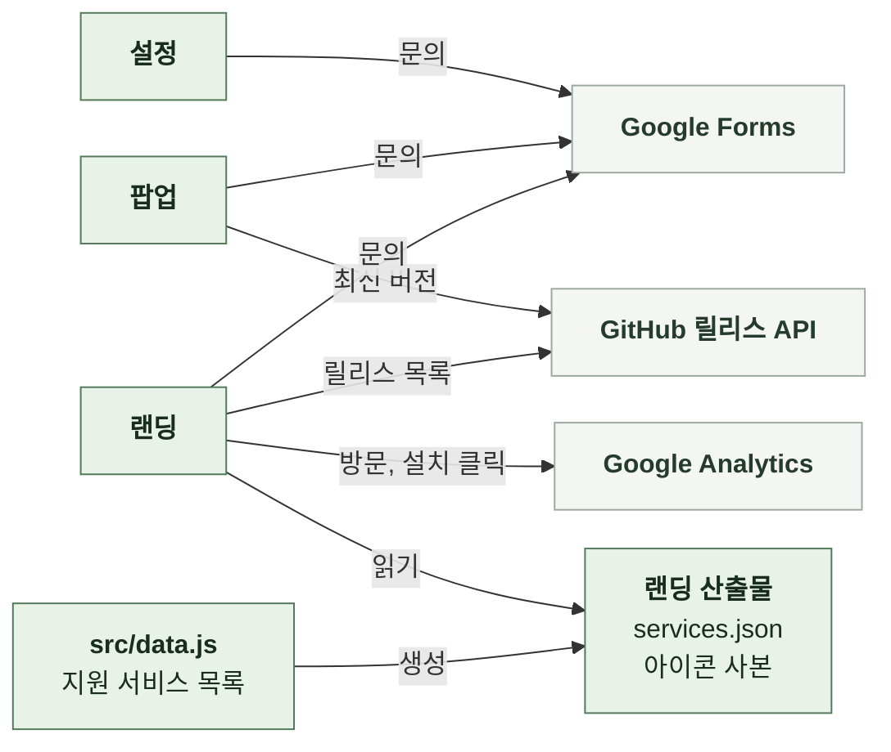

# 5. 계약

이 문서는 LinKHU가 바깥과 주고받는 값의 계약을 정한다. 상대는 랜딩이 받는 생성 산출물, GitHub 릴리스 API, Google Forms, Google Analytics 넷이다.

실패했을 때의 화면 동작은 오류 처리에, 생성 스크립트의 실행과 검사는 데이터에, 저장 키는 상태에 있다. ([7-1 오류 처리](7-1-ERROR-HANDLING.md), [6-2-4 검증 파이프라인](6-2-DATA.md#6-2-4-검증-파이프라인), [4-5-1 저장 키 목록](4-5-STATE.md#4-5-1-저장-키-목록))

서버가 없으므로 자체 API는 없다. 바깥 호출은 모두 부가 기능이고, 실패해도 바로가기를 여는 일은 막지 않는다.



<br>

## 5-1 랜딩 파생 산출물

`src/data.js`가 지원 서비스 목록의 원본이다. 확장의 두 화면은 목록 전역을 직접 읽고, 랜딩은 확장 파일을 읽을 수 없어 생성 스크립트가 만든 산출물을 받는다.

| 산출물 | 내용 |
| --- | --- |
| `landing/assets/services.json` | 서비스마다 `id`, `name`, `url`, `category`, `imgSrc` 다섯 필드를 이 순서로 직렬화한 배열. 들여쓰기 2칸, 끝에 개행 |
| `landing/assets/images/` | 서비스가 쓰는 라이트 아이콘과 그 다크 짝의 사본. 같은 경로 구조 |

```json
[
  {
    "id": "info21",
    "name": "인포21",
    "url": "https://portal.khu.ac.kr",
    "category": "학사·포털",
    "imgSrc": "images/common/portal.png"
  }
]
```

| 규칙 | 이유 |
| --- | --- |
| 데이터 스키마가 그대로 계약이다. 여섯 번째 필드를 넣지 않는다 | 필드를 늘리면 데이터, 검증기, 랜딩을 함께 바꾸는 계약 변경이 된다 |
| 두 산출물은 생성물이다. 직접 고치지 않는다 | 손으로 고치면 원본과 어긋난다 |
| 더 이상 쓰이지 않는 아이콘 사본은 생성할 때 지운다 | 지운 서비스의 아이콘이 랜딩에 남지 않는다 |
| 랜딩은 산출물을 같은 사이트에서 받는다. 저장소에 커밋된 산출물이 그대로 배포된다 | 배포 단계에 생성 스크립트가 없다 |

<br>

## 5-2 GitHub 릴리스 API

| 항목 | 확장 | 랜딩 |
| --- | --- | --- |
| 주소 | `https://api.github.com/repos/kangkyunghyun/LinKHU/releases/latest` | `https://api.github.com/repos/kangkyunghyun/LinKHU/releases` |
| 부르는 곳 | 팝업의 버전 안내 | 업데이트 구역 |
| 목적 | 최신 릴리스 버전 조회 | 최근 릴리스 변경 이력 표시 |
| 캐시 | 확장 저장소에 12시간 | 탭 세션 저장소에 탭을 닫을 때까지 |

```text
GET https://api.github.com/repos/kangkyunghyun/LinKHU/releases/latest

200 {
  "tag_name": "v2.9.0",
  "name": "v2.9.0",
  "published_at": "2026-10-14T15:38:39Z",
  "draft": false,
  "body": "### Features\n- ...\n\n### Internal\n- ..."
}
```

랜딩이 받는 목록 응답은 위 객체의 배열이다. 두 쪽 모두 아래 필드만 읽고 나머지는 쓰지 않는다.

| 필드 | 확장 | 랜딩 | 없거나 형식이 다르면 |
| --- | --- | --- | --- |
| `tag_name` | 앞의 `v`를 떼고 매니페스트 버전과 비교 | 릴리스 제목 | 확장은 비교를 건너뜀<br>랜딩은 `name`으로 대신함 |
| `name` | 읽지 않음 | `tag_name`이 없을 때 제목 | 빈 제목 |
| `published_at` | 읽지 않음 | 릴리스 날짜 | 날짜를 빼고 보임 |
| `draft` | 읽지 않음 | `true`면 제외 | 게시된 릴리스로 봄 |
| `body` | 읽지 않음 | 변경 내용 | 빈 본문 |

| 규칙 | 이유 |
| --- | --- |
| 확장의 호스트 권한은 최신 릴리스 주소 하나로 좁힌다 | 최소 권한 |
| 확장은 조회 결과를 12시간 캐시한다 | GitHub의 비인증 한도에 걸리면 모든 사용자의 버전 안내가 함께 실패한다 |
| 랜딩은 탭 세션마다 한 번만 부른다 | 비인증 한도가 방문자 IP 기준 60회/시간인데 학내망은 NAT로 IP를 공유해 한도가 함께 소진될 수 있다 |
| 랜딩은 게시된 릴리스 중 최근 다섯 개만 그리고, 가장 최근 하나만 펼친다 | 접어도 목록이 길면 소개 흐름을 끊는다 |
| 응답 `body`는 신뢰하지 않는다. HTML로 해석하지 않고 요소를 만들어 글자로만 넣는다 | 릴리스 노트 안의 태그가 페이지에서 실행되지 않는다 |
| `body`의 `### Internal` 절은 그리지 않는다 | 내부 정리 기록은 사용자가 겪는 변화가 아니다 |
| `body`는 제목(`### `), 목록(`- `), 백틱으로 감싼 코드만 표기로 그리고 나머지 줄은 문단으로 보인다. 마크다운 파서를 넣지 않는다 | 릴리스 노트가 쓰는 표기가 이 셋뿐이고, 의존성 없는 구성을 지킨다 |

<br>

## 5-3 Google Forms

| 항목 | 값 |
| --- | --- |
| 주소 | Google Forms `formResponse` 엔드포인트 |
| 부르는 곳 | 확장의 문의 스크립트(팝업, 설정), 랜딩 |
| 목적 | 세 경로의 문의를 폼 하나로 수집 |
| 전송 방식 | `POST`, `mode: "no-cors"` |

| 필드 | 내용 | 필수 |
| --- | --- | --- |
| `entry.1096769292` | 문의 본문 | 필수. 비면 보내지 않음 |
| `entry.491031779` | 답변받을 이메일 | 선택. 비면 필드를 싣지 않음 |
| `entry.275621407` | 문의 유형 | 폼 질문은 필수가 아님. 화면은 항상 고른 값을 채워 보냄 |

| 표시 순서 | 유형 값 |
| --- | --- |
| 1 | `오류 제보` |
| 2 | `기능 건의` |
| 3 | `기타` |

```text
POST https://docs.google.com/forms/d/e/<폼 ID>/formResponse   (mode: "no-cors")
entry.1096769292=경영대 홈페이지 주소가 바뀌었습니다
entry.275621407=오류 제보
```

| 규칙 | 이유 |
| --- | --- |
| 유형은 별도 필드로 보내고 본문에 유형 접두어를 붙이지 않는다 | 응답 시트에서 유형으로 거를 수 있다 |
| 네트워크 오류가 없으면 전송된 것으로 본다 | Google Forms가 CORS 응답 헤더를 주지 않아 응답 본문을 읽을 수 없다. 성공 문구도 이 한계를 전제로 정한다 |
| 폼 주소와 필드 id는 소스에 그대로 둔다 | 공개돼도 남이 할 수 있는 일은 폼에 응답을 넣는 것뿐이다 |
| 확장과 랜딩은 같은 폼, 같은 필드, 같은 유형 값을 쓴다 | 경로가 갈라지면 수집 결과가 나뉜다. 테스트가 일치를 검증한다 |

<br>

**1. 폼이 만족해야 하는 조건**

질문 구성과 설정이 아래와 다르면 전송이 조용히 실패한다. 폼을 만들거나 고칠 때 이 표가 계약이다.

| 항목 | 값 | 어기면 |
| --- | --- | --- |
| 질문 1 | 장문형 `문의 내용`, 필수 | 전송 주소는 공개 페이지에 있어 누구나 직접 POST할 수 있다. 필수가 아니면 외부에서 온 빈 요청이 그대로 저장된다 |
| 질문 2 | 단답형 `답변 받을 이메일`, 필수 아님 | |
| 질문 3 | 객관식 `문의 유형`, 필수 아님. 선택지는 위 유형 값과 같은 글자, 같은 순서 | 필수이면 유형 없이 보내는 요청이 저장되지 않는다<br>전송값이 선택지와 한 글자라도 다르면 응답이 거부된다 |
| 설정 탭의 "이메일 주소 수집" | 사용 안 함 | 익명 전송이 필수 필드 누락으로 저장되지 않는다 |

<br>

**2. 확장과 랜딩에 연결하는 값**

확장의 문의 스크립트와 랜딩 스크립트가 같은 네 값을 갖는다.

| 값 | 내용 |
| --- | --- |
| 폼 주소 | `https://docs.google.com/forms/d/e/<폼 ID>/formResponse` |
| 본문 필드 | `entry.1096769292` |
| 이메일 필드 | `entry.491031779`. 이메일 질문이 없으면 빈 값으로 두고, 그러면 이메일 입력란이 화면에 나타나지 않는다 |
| 유형 필드 | `entry.275621407` |

값은 폼 편집 화면의 ⋮ 메뉴에서 **미리 채워진 링크 받기**로 얻는다. 받은 URL의 `viewform`을 `formResponse`로 바꾼 것이 폼 주소이고, `entry.*` 파라미터가 각 질문의 id다. 폼 주소나 본문 필드가 비어 있으면 보내기를 눌렀을 때 문의 채널 준비 중 안내가 보인다.

<br>

**3. 조용히 실패하는 것**

응답 본문을 읽을 수 없으므로 아래는 모두 오류 없이 잘못된 결과만 남기고, 화면에는 전송 완료 안내가 뜬다.

| 잘못된 것 | 결과 | 잡는 방법 |
| --- | --- | --- |
| 필드 id 오타 | 응답이 저장되지 않거나 빈 채로 저장 | 테스트 전송, 라이브 폼 점검 |
| `문의 내용`이 필수가 아님 | 외부에서 온 빈 요청이 그대로 저장 | 라이브 폼 점검 |
| "이메일 주소 수집" 켜짐 | 익명 전송이 저장되지 않음 | 테스트 전송 |
| 유형 질문이 필수 | 유형 없는 요청이 저장되지 않음 | 라이브 폼 점검, 유형 없는 테스트 전송 |
| 유형 전송값과 객관식 선택지 불일치 | 응답이 거부되어 저장되지 않음 | 선택지와 전송값 대조, 테스트 전송 |

폼 설정을 바꿀 때마다 테스트 전송과 라이브 폼 점검을 함께 한다.

<br>

**4. 응답을 받는 쪽**

폼의 **응답** 탭에서 새 응답 이메일 알림을 켜 둔다. 알림에는 새 응답 안내와 링크만 담기고 문의 내용은 담기지 않는다. Google Forms 기본 동작이라 바꿀 수 없다. 응답은 시트에 쌓여 유실되지 않으므로 내용까지 메일로 받는 Apps Script 트리거는 두지 않는다.

<br>

## 5-4 Google Analytics

랜딩만 Google Analytics(측정 ID `G-NHV31WF5ZM`)를 쓴다. 확장에는 분석 도구가 없다.

| 이벤트 | 보내는 때 |
| --- | --- |
| 기본 페이지 조회 | 랜딩을 열 때 |
| `click_chrome_store` | Chrome Web Store 링크를 누를 때 |
| `click_firefox_store` | Firefox Add-ons 링크를 누를 때 |
| `click_whale_store` | Whale Store 링크를 누를 때 |
| `copy_pc_install_link` | 휴대폰 설치 안내에서 링크 복사를 누를 때. 복사 성공 여부와 무관 |
| `view_qr_code` | 휴대폰 설치 안내에서 QR 코드를 펼칠 때 |

| 규칙 | 이유 |
| --- | --- |
| 분석 스크립트는 비동기로 불러오고, 아직 없으면 이벤트를 보내지 않는다 | 분석 스크립트가 늦거나 막혀도 랜딩은 그대로 동작한다 |
| 스토어 링크 클릭은 링크의 호스트 이름으로 판별해 한 곳에서 보낸다 | 스토어 링크가 페이지 여러 곳에 있다 |
| 이벤트에 입력값이나 개인 정보를 싣지 않는다 | 방문과 설치 의도만 센다 |

<br>

## 5-5 공통 원칙

| 원칙 | 이유 |
| --- | --- |
| 비밀 키가 필요한 연동은 쓰지 않는다 | 확장과 랜딩은 소스가 공개되므로 어떤 비밀값도 숨길 수 없다 |
| 바깥 호출이 실패해도 화면 사용을 막지 않는다 | 바로가기를 여는 것이 제품의 본체다 |
| 사용자에게 보일 내용만 고른다 | 받은 값을 그대로 노출하지 않는다 |
| 파서 같은 의존성을 늘리지 않는다 | 의존성 없는 구성을 지킨다 |
| 응답은 신뢰하지 않는 입력으로 다루고, 실패하면 조용히 대체 동작으로 넘어간다 | 바깥 서비스는 통제할 수 없다 |
