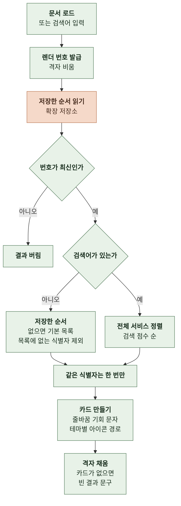
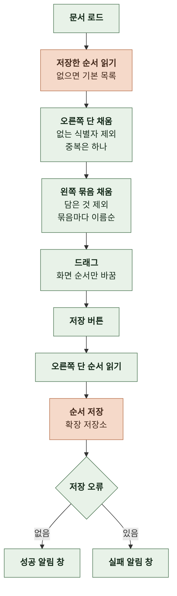
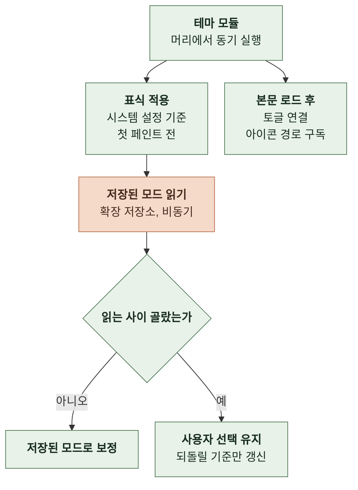
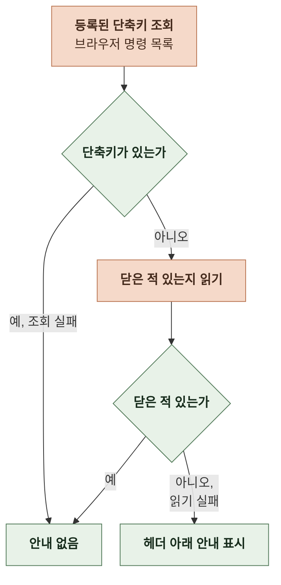
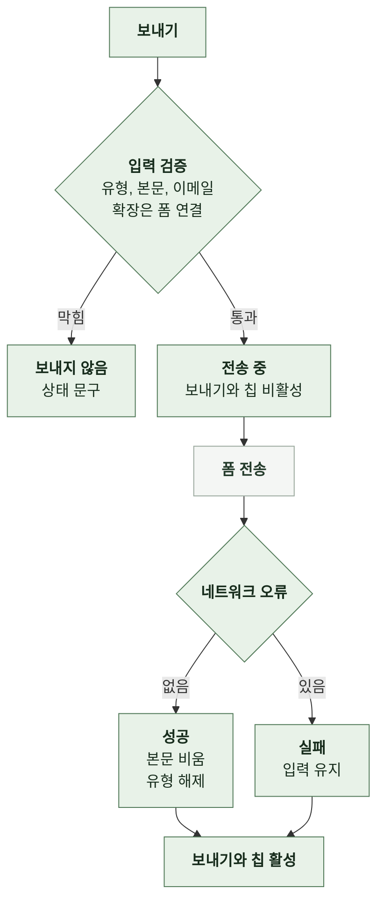
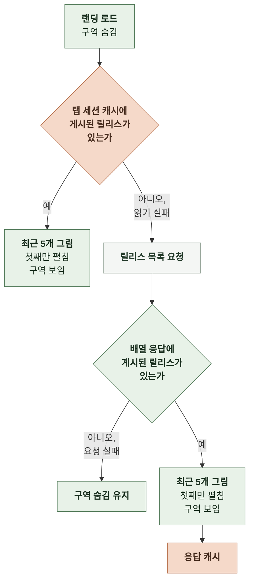
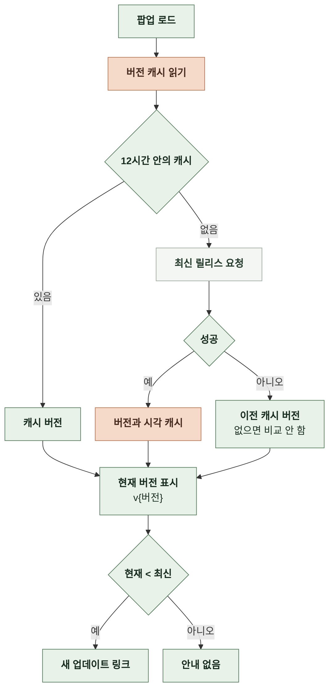

# 6-1 인터랙션

이 문서는 팝업, 설정, 랜딩이 입력을 받고 다시 그릴 때까지의 처리 순서와, 순서를 바꾸면 깨지는 지점을 정한다.

저장 시점과 늦게 도착한 결과의 처리는 상태에, 모듈 로드 순서는 소프트웨어 아키텍처에, 검색 순위는 정보 구조에, 테마 저장 규칙은 테마에, 화면 문구와 배치는 레이아웃에, 실패 시 동작과 문구는 오류 처리에 있다. ([4-5 상태](4-5-STATE.md), [4-4-5 모듈 구조](4-4-SOFTWARE-ARCHITECTURE.md#4-4-5-모듈-구조), [3-5 검색이 다루는 범위](3-INFORMATION-ARCHITECTURE.md#3-5-검색이-다루는-범위), [4-3 테마](4-3-THEME.md), [4-1 레이아웃](4-1-LAYOUT.md), [7-1 오류 처리](7-1-ERROR-HANDLING.md))

 

### 6-1-1 팝업 렌더

팝업은 처음 열릴 때와 검색어가 바뀔 때마다 같은 순서로 다시 그린다.

| 지킬 것 | 어기면 |
| --- | --- |
| 렌더 번호 발급이 저장소 읽기보다 먼저 | 두 요청이 같은 번호를 나눠 가짐 |
| 아이콘은 처음 그릴 때부터 현재 테마의 경로 | 라이트로 그린 뒤 바꾸면 한 번 깜빡임 |

| 카드 | 내용 |
| --- | --- |
| 요소 | 서비스 주소를 가진 링크 |
| 아이콘 대체 텍스트 | 서비스 이름 |
| 아이콘 끌기 | 막음 |

 

### 6-1-2 키 입력

| 키 | 동작 | 동작하지 않는 조건 |
| --- | --- | --- |
| 검색창 입력 | 앞뒤 공백을 뺀 검색어로 6-1-1을 다시 실행. 대상은 전체 서비스 | |
| 검색창의 `Enter` | 화면의 첫 카드를 현재 탭에서 열고 팝업을 닫음. 검색어가 비면 내 바로가기의 첫 카드. 현재 탭을 찾지 못하면 새 탭 | 한글 조합 중, 키 반복 입력, 카드 없음 |
| `/` | 검색창으로 포커스 | 화면 단축키가 아님 |
| `1`~`9` | 화면의 n번째 카드를 일반 클릭한 것과 같이 엶 | 화면 단축키가 아님, n번째 카드 없음 |

| 화면 단축키가 아닌 입력 | 팝업과 설정 공통 |
| --- | --- |
| 포커스 | 입력창, 여러 줄 입력, 선택 상자, 편집 가능한 영역 |
| 함께 누른 키 | `Ctrl`, `Alt`, `Cmd` |
| 반복 | 키를 누른 채 반복 입력 |

 

### 6-1-3 이동 처리

카드의 링크 기본 동작은 막고 확장 API로 연다. 기본 동작을 두면 팝업 화면 자체가 이동한다.

| 입력 | 여는 방법 | 팝업 |
| --- | --- | --- |
| 일반 클릭, `Shift` + 클릭 | 새 탭을 앞에 엶 | 닫힘 |
| `Ctrl`/`Cmd` + 클릭 | 새 탭을 뒤에 엶 | 유지 |
| 휠(가운데) 클릭 | 보조 버튼 클릭으로 받아 새 탭을 뒤에 엶 | 유지 |
| 검색창의 `Enter` | 현재 탭에서 엶 | 닫힘 |
| 푸터의 홈페이지 | 랜딩을 새 탭 앞에 엶 | 닫힘 |
| 헤더의 새 업데이트 | 링크 기본 동작으로 새 탭에 엶. 갈 곳은 6-1-12 | |
| 헤더의 설정 버튼 | 설정 페이지를 탭으로 엶 | |

 

### 6-1-4 설정 저장

| 드래그 | 동작 |
| --- | --- |
| 시작 | 오른쪽 단과 끌고 있는 항목의 카테고리 묶음만 주색 옅음 배경과 안쪽 주색 윤곽으로 강조함. 끌리는 항목은 반투명 0.5, 주색 옅음 배경, 주색 테두리 |
| 새 탭 링크에서 시작 | 드래그를 취소함 |
| 오른쪽 단 위 | 포인터 세로 좌표가 중심보다 위인 가장 가까운 항목 앞에 끼움. 없으면 맨 끝 |
| 왼쪽 단 위 | 항목을 원래 카테고리 묶음으로 보내고 그 묶음을 이름순으로 다시 놓음 |
| 가장자리 | 스크롤 영역 위아래 `40px` 안이면 그 방향으로 `16ms`마다 `8px` 자동 스크롤. 영역을 벗어나도 마지막 영역 기준으로 이어짐 |
| 끝 | 강조와 자동 스크롤을 멈추고 왼쪽 목록을 다시 그림 |

| 저장 | 규칙 |
| --- | --- |
| 순서의 출처 | 오른쪽 단에 실제로 놓인 항목. 검색어와 필터는 영향이 없음 |

 

### 6-1-5 테마 적용

| 화면 | 규칙 |
| --- | --- |
| 확장 | 표식 적용과 토글 연결은 서로 기다리지 않음. 칠해진 테마가 바뀌면 알림을 받아 그려진 아이콘의 경로만 바꿈. 구독은 여럿을 받고 각자 해지할 수 있음 |
| 랜딩 | 저장된 모드를 동기로 읽어 첫 페인트 전에 한 번 칠함. 다시 칠할 때마다 그려진 아이콘의 경로를 직접 바꿈 |
| 공통 | 문서 루트에 칠한 테마와 고른 모드를 따로 표시함. 토글 아이콘은 고른 모드를 따름 |

 

### 6-1-6 단축키 안내

다른 프로그램이 같은 조합을 쓰면 설치할 때 팝업 단축키가 등록되지 않는다. 단축키가 비어 있으면 사용자가 직접 지정할 위치를 알린다.

| 팝업 상황 | 동작 |
| --- | --- |
| 명령 목록 API가 없음 | 아무것도 하지 않음 |
| 닫기를 누름 | 바로 숨기고 닫았음을 저장함 |
| 닫기를 저장하는 중에 다시 누름 | 무시함 |
| `설정에서 지정`을 누름 | 설정 페이지의 단축키 안내 위치를 새 탭으로 엶 |

| 설정 상황 | 동작 |
| --- | --- |
| 단축키가 비어 있음 | 단축키 안내 구역을 보임 |
| 등록되어 있거나 명령 목록 API가 없음 | 구역을 숨김 |
| 단축키 안내 위치로 열림 | 그 구역으로 스크롤함 |
| 주소 버튼을 누름 | 그 주소를 새 탭으로 엶. 브라우저가 막으면 주소를 클립보드에 복사하고 알림 창 |

| 단축키 안내 구역 문구 |
| --- |
| "브라우저 확장 프로그램 단축키 설정 화면에서 LinKHU 단축키를 직접 지정해주세요. 브라우저나 다른 프로그램이 같은 조합을 이미 쓰면 등록되지 않습니다." |
| "Chromium 기반 브라우저는 브라우저 내부 주소에 `/extensions/shortcuts`를 붙여 단축키 설정으로 이동합니다. 아래 목록에 없는 브라우저는 `<브라우저 이름>://extensions/shortcuts` 형식을 참고해주세요." |

| 브라우저 | 주소 버튼 |
| --- | --- |
| Chrome | `chrome://extensions/shortcuts` |
| Whale | `whale://extensions/shortcuts` |
| Aside | `aside://extensions/shortcuts` |
| Firefox | `about:addons`. 뒤에 "→ 톱니바퀴 메뉴 → 확장 기능 단축키 관리" |

 

### 6-1-7 문의 유형 선택과 전송

| 상황 | 동작 |
| --- | --- |
| 처음 열었을 때 | 유형이 선택되지 않음 |
| 칩을 누름 | 그 칩만 선택. 선택한 칩은 `aria-pressed="true"`, 나머지는 `"false"` |
| 패널을 열 때 | 본문 입력에 포커스 |
| 패널을 닫았다 다시 엶 | 입력과 선택이 그대로 |
| 확장 패널 | 문의하기를 누를 때마다 펼치고 접음 |
| 랜딩 대화상자 | 문의 버튼으로 모달을 열고 닫기 버튼이나 `Esc`로 닫음 |

 

### 6-1-8 설정 검색과 필터

| 상황 | 동작 |
| --- | --- |
| 검색 | 순위 없이 왼쪽 목록을 걸러 냄. `Enter`로 열지 않음 |
| `/` | 검색창으로 포커스. 화면 단축키 판정은 팝업과 같음 |
| 필터 칩을 누름 | 그 카테고리를 고르거나 해제함. 여러 개를 함께 고를 수 있음 |
| 카테고리를 하나도 고르지 않음 | 전체 |
| 검색어와 필터 | 둘 다 만족하는 것만 |
| 고른 카테고리 | 저장하지 않음. 다시 열면 전체 |
| 검색어나 필터가 걸림 | 결과가 없는 묶음을 숨기고, 전체 결과가 없으면 빈 결과 문구 |
| 오른쪽 내 바로가기 | 검색어와 필터의 영향을 받지 않음 |

 

### 6-1-9 랜딩 검색

| 상황 | 동작 |
| --- | --- |
| 목록을 받기 전 | 상태 "서비스 목록을 불러오는 중입니다." |
| 검색어 없음 | 인포21, e-Campus, 수강신청. 상태 "자주 찾는 서비스 {n}개" |
| 검색어 입력 | 점수 순 최대 5개. 상태 "“{검색어}” 검색 결과 {n}개" |
| 결과 없음 | 상태 "“{검색어}” 검색 결과 없음", 목록 "검색 결과가 없습니다. 다른 이름이나 카테고리로 찾아보세요." |
| 검색창의 `Enter` | 첫 결과를 새 탭에서 엶 |
| 검색창의 `↓` | 첫 결과로 포커스 |
| 결과에서 `↑`, `↓` | 결과 사이를 오가고 끝에서 반대쪽 끝으로 돎 |
| 검색창의 `Esc` | 검색어를 비움 |
| 결과에서 `Esc` | 검색창으로 돌아감 |
| `/` | 검색창으로 포커스. 입력창, 여러 줄 입력, 편집 가능한 영역에 포커스가 있거나 `Ctrl`, `Cmd`가 함께 눌렸으면 받지 않음 |
| 스크립트 꺼짐 | "검색 기능을 사용하려면 JavaScript를 켜주세요." |

| 결과 항목 | 내용 |
| --- | --- |
| 링크 | 새 창. 접근성 이름 "{이름}, {카테고리}, 새 창에서 열기" |
| 표시 | 테마별 아이콘, 굵은 이름, 보조 줄 "{카테고리} · {식별자}", 오른쪽 홑화살괄호 |

 

### 6-1-10 랜딩 업데이트 구역

| 항목 | 내용 |
| --- | --- |
| 릴리스 항목 | 접고 펴는 상자. 제목 줄은 태그 이름과 날짜, 본문은 5-3의 그리는 방법 |
| 가는 길 | 맨 아래 "업데이트 내역" 링크. 창 폭이 900px보다 넓으면 위 메뉴 "업데이트" |
| 더 오래된 이력 | 구역 아래 "GitHub에서 전체 릴리스 보기" |

 

### 6-1-11 휴대폰 설치 안내

| 상황 | 동작 |
| --- | --- |
| 기기 판정 | 사용자 에이전트에 Android, iPhone, iPad, iPod, Windows Phone이 있으면 휴대폰. Macintosh이면서 터치 지점이 2개 이상이면 iPad. 데스크톱 모드로 연 Android 태블릿은 PC |
| 휴대폰 | 히어로 버튼 아래에 안내를 보임. PC에서는 숨김 |
| 안내 | 제목 "LinKHU는 PC 브라우저에서 설치할 수 있습니다", 설명 "지금 보는 주소를 PC로 옮기면 바로 설치할 수 있습니다.", 주소 `https://kangkyunghyun.github.io/LinKHU/` |
| 링크 복사 | 위 주소를 클립보드에 복사함 |
| QR 코드 보기 | QR 코드를 펼치고 버튼 이름을 "QR 코드 숨기기"로 바꿈. 다시 누르면 접음 |
| QR 코드 | `200×200`. 같은 주소에 `utm_source=qr`을 붙인 값. 설명 "PC나 다른 기기의 카메라로 스캔하세요." |

 

### 6-1-12 버전 안내

| 항목 | 규칙 |
| --- | --- |
| 비교 | 점으로 나눈 숫자를 자리마다 비교. 자리 수가 다르면 없는 자리를 0으로 봄 |
| 링크 문구 | "새 업데이트". 툴팁 "최신 버전 v{최신}" |

| 설치 | 브라우저 | 링크가 가는 곳 |
| --- | --- | --- |
| 스토어 설치본 | Whale | `https://store.whale.naver.com/detail/njhgalaophlilmhapklabocladclmhoc` |
| 스토어 설치본 | Firefox | `https://addons.mozilla.org/ko/firefox/addon/linkhu` |
| 스토어 설치본 | 그 밖 | `https://chromewebstore.google.com/detail/ihidkmjkpfphgljieecfcikljaopcldp` |
| 스토어 설치본이 아님 | 모두 | `https://github.com/kangkyunghyun/LinKHU/releases/latest` |

스토어 설치본은 매니페스트에 스토어 업데이트 주소가 있는 것으로 판정하고, 브라우저는 사용자 에이전트로 판정한다.
