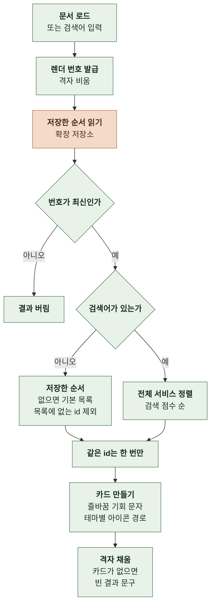
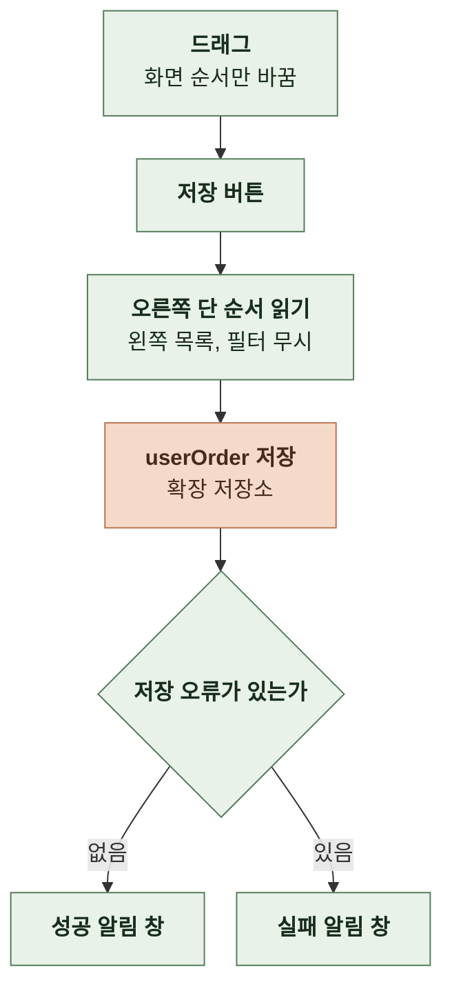
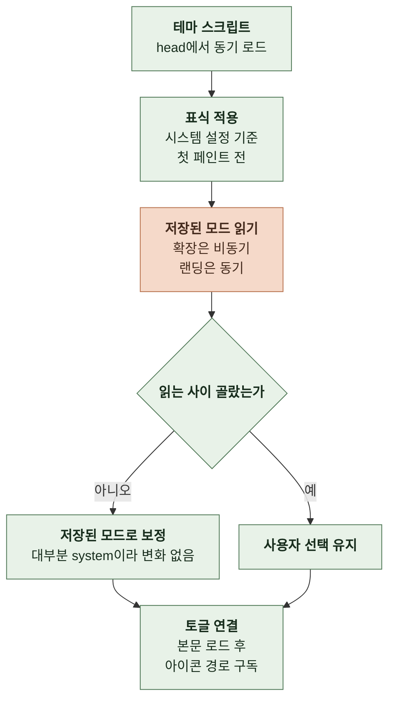
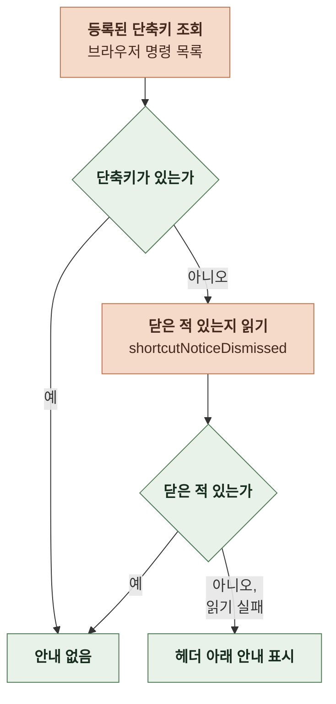

# 6-1. 인터랙션

이 문서는 화면이 입력을 받고 다시 그릴 때까지의 처리 순서와, 순서를 바꾸면 깨지는 지점을 정한다.

저장 키와 늦게 도착한 결과의 처리는 상태에, 검색 순위는 정보 구조에, 테마 저장 규칙은 테마에, 실패 시 화면 동작은 오류 처리에 있다. ([4-5 상태](4-5-STATE.md), [3-5 검색이 다루는 범위](3-INFORMATION-ARCHITECTURE.md#3-5-검색이-다루는-범위), [4-3 테마](4-3-THEME.md), [7-1 오류 처리](7-1-ERROR-HANDLING.md))

 

## 6-1-1 팝업 렌더

팝업은 처음 열릴 때와 검색어가 바뀔 때마다 같은 순서로 다시 그린다.

| 지킬 것 | 어기면 |
| --- | --- |
| 렌더 번호 발급이 저장소 읽기보다 먼저다 | 두 요청이 같은 번호를 나눠 갖는다 |
| 콜백 진입부에서 번호를 확인하고 최신이 아니면 바로 끝낸다 | 검색어를 빠르게 칠 때 늦게 도착한 이전 결과가 최신 화면을 덮는다 |
| 없는 id 제외와 중복 제거는 그릴 때 한다 | 저장된 값을 고쳐 쓰게 되어 사용자가 하지 않은 쓰기가 일어난다 |
| 아이콘은 처음 그릴 때부터 현재 테마의 경로를 쓴다 | 라이트로 그린 뒤 바꾸면 한 번 깜빡인다 |

 

## 6-1-2 키 입력

| 키 | 동작 | 동작하지 않는 조건 |
| --- | --- | --- |
| 검색창 입력 | 앞뒤 공백을 뺀 검색어로 6-1-1을 다시 실행한다. 대상은 내 바로가기가 아니라 전체 서비스다 | |
| 검색창의 `Enter` | 첫 결과를 현재 탭에서 열고 팝업을 닫는다. 현재 탭을 찾지 못하면 새 탭으로 연다 | 한글 조합 중, 키를 누른 채 반복 입력, 결과 없음 |
| `/` | 검색창으로 포커스를 옮긴다 | 화면 단축키 판정에서 제외되는 입력 |
| `1`~`9` | 화면에 보이는 n번째 카드를 일반 클릭한 것과 같이 연다 | 화면 단축키 판정에서 제외되는 입력 |

화면 단축키 판정은 입력 요소에 포커스가 있거나, `Ctrl`, `Alt`, `Cmd`가 함께 눌렸거나, 키를 누른 채 반복 입력이면 단축키로 받지 않는다. 한글 조합을 확정하려고 누른 `Enter`가 링크를 열면 글자를 지우고 다시 쳐야 하므로 조합 중에는 열지 않는다.

 

## 6-1-3 이동 처리

카드는 주소를 가진 링크로 만들되 기본 동작을 막고 확장 API로 연다. 링크의 기본 동작을 그대로 두면 팝업 화면 자체가 이동한다.

| 입력 | 여는 방법 | 팝업 |
| --- | --- | --- |
| 일반 클릭, `Shift` + 클릭 | 새 탭을 앞에 연다 | 닫힌다 |
| `Ctrl`/`Cmd` + 클릭 | 새 탭을 뒤에 연다 | 유지 |
| 휠(가운데) 클릭 | 새 탭을 뒤에 연다 | 유지 |
| 검색창의 `Enter` | 현재 탭에서 연다 | 닫힌다 |
| 푸터의 홈페이지 | 새 탭을 앞에 연다 | 닫힌다 |

| 지킬 것 | 이유 |
| --- | --- |
| 휠 클릭은 보조 버튼 클릭 이벤트로 받는다 | 휠 클릭은 일반 클릭 이벤트로 오지 않는다 |
| 카드의 링크 주소를 비워 두지 않는다 | 주소가 있어야 커서를 올렸을 때 주소가 보이고 접근성 트리에 링크로 잡힌다 |
| 현재 탭에서 여는 것은 검색창의 `Enter`뿐이다 | 그 밖의 경로는 모두 새 탭이다 |

 

## 6-1-4 설정 저장

| 지킬 것 | 이유 |
| --- | --- |
| 저장은 버튼에서만 일어난다 | 드래그 도중 저장하면 되돌릴 수 있는 조작과 확정이 섞인다 |
| 순서는 오른쪽 단에 실제로 놓인 항목에서 읽는다 | 검색어와 필터는 왼쪽 표시에만 영향을 주므로 필터를 건 채 저장해도 결과가 같아야 한다 |
| 오른쪽에서 왼쪽으로 옮긴 항목은 원래 카테고리 묶음의 이름순 자리로 돌아간다 | 왼쪽 목록은 항상 이름 가나다순이다 |
| 새 탭 링크를 누른 채 시작한 드래그는 취소한다 | 링크를 끌었을 뿐인데 항목이 딸려 가면 안 된다 |
| 스크롤 영역 위아래 가장자리 40px 안으로 끌면 그 방향으로 자동 스크롤한다 | 이 도움이 없으면 긴 학과 목록에서 위쪽으로 항목을 옮기기 어렵다 |

 

## 6-1-5 테마 적용

| 지킬 것 | 이유 |
| --- | --- |
| 표식은 첫 페인트 전에 붙는다. 테마 스크립트만 `<head>`에서 동기 로드한다 | 본문 뒤로 미루면 라이트로 한 번 그린 뒤 다크로 바뀌는 깜빡임이 보인다 |
| 랜딩은 저장소 읽기가 동기라 첫 페인트 전에 최종 모드를 안다 | 보정 단계가 없다 |
| 서비스 아이콘은 칠해진 테마가 바뀔 때 알림을 받아 이미 그려진 아이콘의 경로만 바꾼다 | 표식만 바꿔서는 이미 그려진 이미지가 따라오지 않는다. 확장과 랜딩이 같다 |
| 구독은 여러 개를 받고 각자 해지할 수 있다 | 아이콘 교체와 토글 표시가 모두 구독자다. 구독 자리가 하나면 나중 등록이 앞 등록을 조용히 덮는다 |

 

## 6-1-6 단축키 안내

팝업은 비동기 확인을 두 번 차례로 한다. 순서를 바꾸면 단축키를 등록한 사용자에게도 저장소를 읽는다.

| 상황 | 동작 |
| --- | --- |
| 브라우저 명령 목록 API가 없는 환경 | 아무것도 하지 않는다. 안내가 없는 것이 잘못된 안내보다 낫다 |
| 명령 목록 조회가 실패했다 | 안내를 띄우지 않는다 |
| 닫기를 눌렀다 | 바로 숨기고 닫은 상태를 저장한다. 저장 중에 다시 누르면 무시한다 |
| `설정에서 지정`을 눌렀다 | 설정 페이지의 단축키 안내 위치(`options.html#shortcut-guide`)를 새 탭으로 연다 |

설정 페이지는 단축키가 비어 있을 때 단축키 안내 구역을 펼친다. 주소에 `#shortcut-guide`가 붙어 열렸으면 그 구역으로 스크롤한다. 브라우저 목록은 설정 페이지에만 둔다.

| 브라우저 | 안내하는 곳 |
| --- | --- |
| Chrome | `chrome://extensions/shortcuts` |
| Whale | `whale://extensions/shortcuts` |
| Aside | `aside://extensions/shortcuts` |
| Firefox | `about:addons`의 톱니바퀴 메뉴에서 확장 기능 단축키 관리 |
| 그 밖의 Chromium 기반 | `<브라우저 이름>://extensions/shortcuts` 형식 |

목록의 주소 버튼을 누르면 그 주소를 새 탭으로 연다. 브라우저가 내부 주소 열기를 막으면 주소를 클립보드에 복사하고 주소창에 붙여 넣으라는 알림 창을 띄운다. 복사도 실패하면 주소를 직접 복사하라고 알린다.
