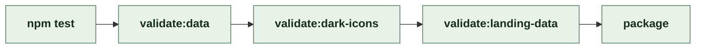

# 6-2 데이터

이 문서는 지원 서비스 목록의 스키마와 필드 규칙, 항목 사이의 제약, 검증과 생성 스크립트의 동작, 데이터를 바꾸는 절차를 정한다.

카테고리 목록과 서비스 수, 기본 목록은 정보 구조에, 아이콘 파일 규칙은 서비스 아이콘에, 랜딩 산출물의 형식은 계약에, 삭제된 id의 처리는 상태에, 검증 실패 출력은 오류 처리에 있다. ([3-2 카테고리](3-INFORMATION-ARCHITECTURE.md#3-2-카테고리), [3-4 기본 목록](3-INFORMATION-ARCHITECTURE.md#3-4-기본-목록), [4-6 서비스 아이콘](4-6-SERVICE-ICON.md), [5-2 랜딩 파생 산출물](5-CONTRACT.md#5-2-랜딩-파생-산출물), [4-5-2 사용자 설정과 내부 캐시](4-5-STATE.md#4-5-2-사용자-설정과-내부-캐시), [7-1-2 데이터 검증 실패](7-1-ERROR-HANDLING.md#7-1-2-데이터-검증-실패))

`src/data.js`의 `MASTER_SITE_LIST`는 LinKHU에서 가장 자주 바뀌는 자산이다. 서비스 하나라도 스키마를 어기면 팝업에 깨진 아이콘이 뜨거나 랜딩 검색이 어긋난다.

 

### 6-2-1 스키마

`MASTER_SITE_LIST`는 서비스 객체의 배열이다. 각 객체는 정확히 다섯 필드를 갖고, 다섯 필드 모두 비어 있지 않은 문자열이다. 빠진 값, 빈 문자열, 공백만 있는 값은 오류다.

| 필드 | 형식 | 제약 | 의미 | 배포한 뒤 |
| --- | --- | --- | --- | --- |
| `id` | `/^[a-z0-9-]+$/`. 소문자 영문, 숫자, 하이픈 | 중복 불가 | 고유 식별자 | 바꾸지 않음 |
| `name` | 문자열 | 중복 불가 | 사용자에게 보이는 이름 | 고쳐도 됨 |
| `url` | `https:` 또는 `http:`로 시작하는 해석 가능한 주소 | 중복 불가 | 이동 주소 | 바꿀 때 HTTPS 지원을 다시 확인 |
| `imgSrc` | `src/` 기준 상대 경로이고 `.png`로 끝남. 예: `images/common/portal.png` | 파일이 실제로 있어야 함. 중복 허용 | 서비스 아이콘 경로 | |
| `category` | `SITE_CATEGORIES`의 값 하나 | | 카테고리 | 바꾸면 계약 변경 |

| 규칙 | 이유 |
| --- | --- |
| 다섯 필드 외의 필드를 넣지 않는다 | 필드를 늘리면 데이터, 이 문서, 검증기, 랜딩 산출물을 함께 바꾸는 계약 변경이다 |
| 기본 목록이나 카드 줄바꿈처럼 화면이 쓰는 표시는 서비스 필드가 아니라 공용 규칙 파일의 상수로 둔다 | 다섯 필드 스키마를 지킨다 |
| 배열의 정의 순서에 의미가 있다 | 검색 점수가 같으면 이 순서로 나온다. 항목을 재배치하면 사용자에게 보이는 검색 결과 순서가 바뀐다 |

 

### 6-2-2 필드 규칙

**1. `id`**

`id`는 사용자의 `userOrder`에 저장되는 값이다. id를 바꾸면 그 서비스를 담아 둔 기존 사용자의 설정에서 항목이 조용히 사라진다. 그릴 때 목록에 없는 id를 거르기 때문이다.

 

**2. `name`**

`name`은 검색 대상이고, 이름 안의 공백은 검색을 방해하지 않는다.

 

**3. `url`의 프로토콜**

프로토콜은 대상 사이트가 무엇을 지원하는지가 정한다.

| 대상 사이트 | 쓸 값 | 검증기 |
| --- | --- | --- |
| HTTPS를 지원한다 | `https://` | 통과 |
| HTTPS를 지원하지 않거나 인증서가 낡아 HTTPS 접속이 실패한다 | `http://` | 경고. 오류가 아니다 |
| 그 밖의 프로토콜 | 쓸 수 없음 | 오류 |
| 해석할 수 없는 주소 | 쓸 수 없음 | 오류 |

`http://` 경고는 고쳐야 할 일이 아니라 확인이 필요한 항목이라는 표시다. HTTPS를 지원하지 않는 것을 확인한 항목만 `http://`로 둔다. HTTPS를 지원하는데 `http://`로 넣으면 확인한 경고와 확인하지 않은 경고를 구분할 수 없게 된다.

 

**4. 교외 도메인**

목록의 대부분은 `khu.ac.kr`이지만 도메인은 등록 기준이 아니다. 기준은 경희대학교 구성원이 자주 쓰는 서비스인가다.

| 규칙 | 이유 |
| --- | --- |
| 경희대 구성원이 학기 중 반복해서 쓰는 서비스면 교외 도메인도 등록하고, 근거를 항목 주석이나 PR에 남긴다 | 다음 사람이 같은 질문을 다시 하지 않는다 |
| 경희대와 무관한 학생 일반 서비스는 등록하지 않는다 | "학생이 쓰니까"를 기준으로 삼으면 목록이 링크 모음이 된다 |

| id | 도메인 | 근거 |
| --- | --- | --- |
| `everytime` | `everytime.kr` | 학교 커뮤니티가 사실상 이곳에 있다 |
| `khcu-portal` | `portal.khcu.ac.kr` | 학점교류로 경희사이버대 강의를 듣는 학생이 학기 내내 쓴다 |
| `khcu-lms` | `lms.khcu.ac.kr` | 위와 같다 |

경희사이버대는 경희대와 별개 법인이다. 재단이 같을 뿐 학번, 포털, 학사 시스템이 따로다. 재단이 같아서가 아니라 학점교류 수강생이 교내 서비스와 같은 빈도로 쓰기 때문에 등록한다.

 

**5. `imgSrc`**

`imgSrc`는 `src/` 바깥을 가리킬 수 없다. `../`로 벗어나는 경로와 절대 경로는 오류다. 패키지에 들어가는 파일만 가리켜야 한다.

 

**6. `category`**

값의 원본은 `src/data.js`의 `SITE_CATEGORIES`다. 검증기의 허용 목록도 같은 값을 갖는다. 값을 늘리거나 바꿀 때는 데이터, `SITE_CATEGORIES`, 검증기 허용 목록, 정보 구조의 카테고리 표를 한 PR에서 함께 바꾼다. 배포된 값을 바꾸면 팝업 검색의 카테고리 일치도 달라진다.

 

### 6-2-3 컬렉션 규칙

`id`, `name`, `url`은 목록 전체에서 중복되면 오류다. `imgSrc`는 중복을 허용한다. 전용 도안이 없는 서비스가 공통 아이콘을 쓸 수 있다.

쓰이지 않는 서비스 이미지가 있으면 오류다. `src/images/common`, `src/images/colleges`, `src/images/departments` 안의 이미지 파일 중 어떤 서비스의 `imgSrc`도 가리키지 않는 파일이 있으면 검증이 실패한다. 다크 벌은 짝 검증이 따로 본다.

 

### 6-2-4 검증 파이프라인

**1. `npm run validate:data`**

`src/data.js`를 격리된 환경에서 평가해 `MASTER_SITE_LIST`를 읽고 아래를 검사한다. 출력과 종료 코드는 오류 처리에 있다.

| 구분 | 검사하는 것 |
| --- | --- |
| 오류 | 필수 필드, `id` 형식과 중복, `name`과 `url` 중복, `category` 허용값, `imgSrc` 확장자와 `src/` 밖 경로와 파일 존재, 쓰이지 않는 이미지, 줄바꿈 표와 한 줄 폭 |
| 경고 | `http://` 주소 |

 

**2. `npm run generate:landing-data`**

`MASTER_SITE_LIST`에서 랜딩 산출물 두 가지를 만들고, 더 이상 쓰이지 않는 아이콘 사본을 지운다.

 

**3. `npm run validate:landing-data`**

같은 스크립트를 검사 모드로 실행한다. `services.json`이 최신인지, 아이콘 사본이 원본과 바이트 단위로 같은지, 쓰이지 않는 사본이 남았는지 확인한다.

 

**4. `npm run build`의 순서**

데이터를 바꾸고 랜딩 산출물 생성을 잊으면 `validate:landing-data`에서 막힌다. CI가 같은 명령을 실행하므로 로컬에서 잊어도 PR에서 걸린다. 패키징은 `src/` 아래에서 이름이 점으로 시작하는 파일과 폴더를 어느 깊이에서든 빼고 나머지를 모두 담는다.

 

### 6-2-5 변경 절차

| 순서 | 할 일 | 확인 |
| --- | --- | --- |
| 1 | `src/data.js`를 고친다. 아이콘을 추가하면 서비스 아이콘 절차로 두 벌을 함께 만든다 | |
| 2 | `npm run generate:landing-data`로 랜딩 산출물을 갱신한다 | |
| 3 | `npm run validate:data`를 실행한다 | 오류 0건. 결과를 PR 본문에 남김 |
| 4 | 팝업과 설정 페이지에서 항목을 확인한다 | 수동 검증의 데이터 변경 항목 |

서비스를 삭제할 때는 아래를 더 확인한다.

| 확인 | 이유 |
| --- | --- |
| 아이콘 파일은 다른 서비스가 참조하지 않을 때만 지운다 | 아이콘은 공유될 수 있어 확인 없이 지우면 남은 서비스의 아이콘이 깨진다 |
| 아무도 참조하지 않게 된 아이콘은 지운다 | 남기면 쓰이지 않는 이미지 오류가 난다 |
| 라이트 아이콘을 지운 뒤 `npm run generate:dark-icons`로 다크 짝을 지운다 | 남기면 짝 검증이 짝 없는 다크 아이콘으로 실패한다 |
| 판단이 서지 않으면 `npm run validate:data`를 돌린다 | 참조 중인 파일을 지우면 없는 파일 오류가, 아무도 안 쓰는 파일을 남기면 쓰이지 않는 이미지 오류가 난다 |

그 서비스를 담아 둔 기존 사용자의 `userOrder`에는 삭제된 id가 남지만 그릴 때 걸러진다.

 

### 6-2-6 URL 점검

링크가 살아 있는지 응답만 보고 판단하면 멀쩡한 사이트를 죽었다고 잘못 판단하기 쉽다.

| 규칙 | 이유 |
| --- | --- |
| 봇 차단과 로그인 페이지를 접속 불가로 보지 않는다. 교체 대상은 명시적인 404뿐이다 | 자동 요청을 막거나 로그인 화면으로 보내는 것은 정상 동작이다 |
| TLS가 낡아 HTTPS만 실패하고 HTTP로는 열리는 사이트는 `http://`로 둔다 | `http://` 경고의 대부분이 이 경우다 |
| 학과 홈페이지가 열리지 않으면 폐쇄로 단정하기 전에 학교 통합 도메인의 하위 경로를 먼저 확인한다 | 개별 도메인을 쓰던 학과가 통합 도메인으로 옮겨 가는 경우가 있다 |
| 판단이 서지 않으면 바꾸지 않고 보류한다 | 살아 있는 링크를 잘못 바꾸면 사용자가 엉뚱한 곳으로 간다 |

URL을 실제로 바꿀 때는 새 주소의 응답을 직접 확인하고 결과를 PR 본문에 남긴다.

 

### 6-2-7 손으로 적은 서비스 수

서비스 수는 데이터에서 계산되는 값이지만 스펙 밖의 문서에 홍보 문구로 손으로 적혀 있다. README 두 개, 랜딩 페이지 본문, 지원 서비스 목록 문서, 스토어 설명(`docs/copy/1-1-STORE-LISTING.md`), 커뮤니티 홍보 글(`docs/copy/1-2-COMMUNITY-POST.md`)이다. 검증 스크립트는 데이터만 보므로 이 숫자의 불일치를 잡지 못한다.

| 규칙 | 내용 |
| --- | --- |
| 서비스를 추가하거나 삭제하는 PR | 문서에 적힌 서비스 수와 정보 구조의 카테고리 표를 함께 갱신한다 |
| 기준값 | 문서가 아니라 `src/data.js`다. 숫자가 서로 다르면 데이터를 세어 맞춘다 |
| 세는 방법 | 검증 스크립트처럼 `src/data.js`를 평가해 카테고리별로 센다 |
