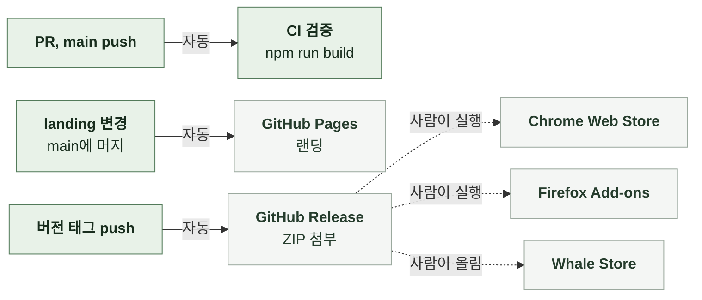

# 7-4. 배포

이 문서는 LinKHU가 나가는 경로와 경로별 트리거, 무엇이 자동이고 무엇이 수동인지, CI 검증, 랜딩 배포를 정한다.

릴리스 절차는 릴리스에, 스토어 제출 절차는 스토어 제출에, 빌드 명령의 순서는 데이터에 있다. ([7-5 릴리스](7-5-RELEASE.md), [7-6 스토어 제출](7-6-STORE.md), [6-2-4 검증 파이프라인](6-2-DATA.md#6-2-4-검증-파이프라인))

 

## 7-4-1 배포 경로

| 경로 | 트리거 | 자동화 |
| --- | --- | --- |
| 검증 | PR, `main` push | 전부 자동 |
| GitHub Release | `v*.*.*` 태그 push | 전부 자동. 릴리스 생성과 ZIP 첨부까지 |
| Chrome Web Store | 수동 실행 | 워크플로. 확인 문자열 필요 |
| Firefox Add-ons | 수동 실행 | 워크플로. 확인 문자열 필요 |
| Whale Store | 수동 | 없음 |
| 랜딩 | `landing/` 아래나 Pages 워크플로 파일의 변경이 `main`에 들어올 때, 수동 실행 | 전부 자동 |

 

## 7-4-2 CI 검증

PR과 `main` push에서 `npm run build`를 실행한다. 테스트, 데이터 검증, 아이콘 짝 검증, 랜딩 산출물 최신 확인, 패키징이 모두 들어 있다. 패키징한 ZIP은 워크플로 산출물로 올린다.

CI가 실패한 PR은 병합하지 않는다. 로컬에서 검증을 잊어도 PR에서 걸리게 하는 장치이기 때문이다.

 

## 7-4-3 랜딩 배포

| 발동 조건 | 비고 |
| --- | --- |
| `landing/` 아래 변경이 `main`에 들어옴 | 가장 흔한 경로 |
| Pages 배포 워크플로 파일이 `main`에서 바뀜 | |
| 수동 실행 | 콘텐츠 변경 없이 다시 배포한다. 배포가 실패했거나 결과가 의심스러울 때 쓴다 |

배포하는 것은 `landing/` 폴더 전체다. 배포가 겹치면 진행 중인 것을 취소하고 새것만 남긴다.

| 규칙 | 내용 |
| --- | --- |
| 빌드 단계 | 없다. `landing/`의 파일이 곧 배포물이다 |
| 생성물 | `landing/assets/services.json`과 `landing/assets/images/`는 저장소에 커밋된 상태로 배포된다. 배포 단계에서 생성 스크립트가 돌지 않으므로, 데이터를 바꾸고 생성을 잊으면 랜딩이 낡은 목록을 보인다. 이를 막는 것이 CI의 랜딩 산출물 최신 확인이다 |
| 확장 버전과의 관계 | 랜딩만 바뀌는 변경은 확장 버전을 올리지 않는다. 두 배포 경로는 서로 독립이다 |
| 반영 확인 | 머지 후 몇 분 뒤 운영 주소에서 직접 확인한다. 페이지뿐 아니라 서비스 목록 데이터와 아이콘까지 응답하는지 본다. 로컬에서 보이던 아이콘이 배포에서 빠진 경우를 여기서 잡는다 |
