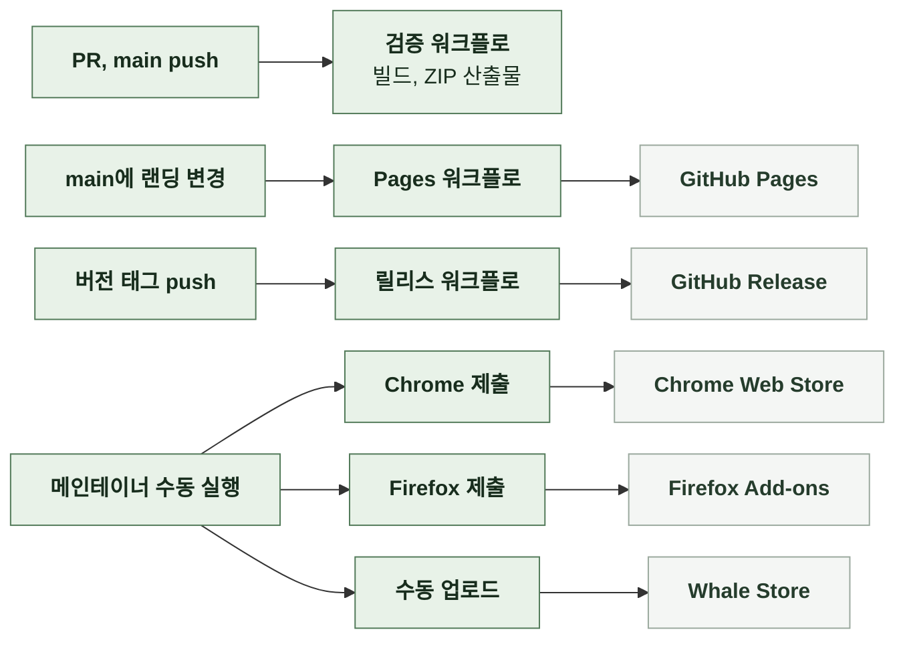

# 7-4 배포

이 문서는 LinKHU의 배포 단위와 대상 브라우저, 배포 경로, 배포 조건, 비밀 정보, 랜딩 배포의 적용과 복구, 배포 후 확인을 정한다.

릴리스 절차는 릴리스에, 스토어 제출 절차와 자격 증명, 스토어 배포 후 확인은 스토어 제출에, 빌드의 구성과 순서는 데이터에, 포크 PR 승인 기준은 작업 하네스에 있다. ([7-5 릴리스](7-5-RELEASE.md), [7-6 스토어 제출](7-6-STORE.md), [7-6-7 배포 후 확인](7-6-STORE.md#7-6-7-배포-후-확인), [6-2-4 검증 파이프라인](6-2-DATA.md#6-2-4-검증-파이프라인), [저장소 AGENTS.md 포크 PR의 CI 승인](../../AGENTS.md#포크-pr의-ci-승인))

 

### 7-4-1 배포 단위와 대상 브라우저

확장과 랜딩은 따로 배포한다. 랜딩만 바뀌는 변경은 확장 버전을 올리지 않는다.

| 단위 | 배포물 | 배포처 |
| --- | --- | --- |
| 확장 | `linkhu-v{version}.zip`. 이름이 점으로 시작하는 것을 뺀 확장 소스 전체 | GitHub Release, 세 스토어 |
| 랜딩 | 랜딩 폴더 전체. 빌드 단계 없이 파일이 곧 배포물 | GitHub Pages |

| ZIP 규칙 | 내용 |
| --- | --- |
| 재현성 | 파일을 경로순으로 담고 시각을 고정함. 같은 커밋에서 만들면 바이트 단위로 같음 |
| 버전 관리 | 패키징 산출물은 커밋하지 않음 |

| 브라우저 | 조건 |
| --- | --- |
| Chrome | Chrome Web Store 배포 |
| Firefox | add-on ID `{7d6a54b3-2e1a-4f8a-96d0-1b2c3d4e5f6a}` 최소 버전 140.0 데이터 수집 권한 `none` 선언 |
| Whale | Chromium 기반. Chrome용 패키지를 그대로 씀 |

 

### 7-4-2 배포 경로

| 경로 | 트리거 | 자동화 |
| --- | --- | --- |
| 검증 | PR, `main` push | 전부 자동. 처음 기여하는 사람의 포크 PR은 메인테이너가 승인한 뒤 실행 |
| GitHub Release | `v*.*.*` 태그 push | 릴리스 생성과 ZIP 첨부까지 자동 |
| Chrome Web Store | 수동 실행 | 워크플로. 확인 문자열 필요 |
| Firefox Add-ons | 수동 실행 | 워크플로. 확인 문자열 필요 |
| Whale Store | 수동 | 없음 |
| 랜딩 | `main`에 랜딩 폴더나 Pages 워크플로 변경이 들어옴, 수동 실행 | 전부 자동 |

| 배포 제어 | 동작 |
| --- | --- |
| 실행 환경 | Node.js 22 |
| 단계 실패 | 후속 단계를 실행하지 않음 |
| 랜딩 배포가 겹침 | 진행 중인 배포를 취소하고 새것만 남김 |
| 스토어 제출 브랜치 | `main`에서만 |

 

### 7-4-3 배포 조건

| 확인 항목 | 기준 | 확인 위치 | 자동 여부 |
| --- | --- | --- | --- |
| 빌드 | 테스트, 데이터 검증, 다크 아이콘 짝 검증, 랜딩 산출물 검사, 패키징 통과. 패키징한 ZIP을 워크플로 산출물로 올림 | 검증 워크플로 | 자동 |
| 병합 | CI가 실패한 PR은 병합하지 않음 | GitHub | 수동 |
| 스펙 | 현재 동작이 바뀌면 같은 PR에서 스펙 갱신 | PR | 수동 |
| 수동 검증 | 변경 유형별 확인 항목 | PR 본문 | 수동 |
| 릴리스 | 태그와 매니페스트 버전 일치, 릴리스 노트 존재 | 릴리스 워크플로 | 자동 |

 

### 7-4-4 비밀 정보

확장과 랜딩은 비밀값을 쓰지 않는다. 비밀값은 스토어 자동 제출만 쓰며 저장소 비밀값으로 관리한다.

| 값 | 위치 | 비밀 여부 |
| --- | --- | --- |
| Chrome OAuth 클라이언트, refresh token, publisher ID | 저장소 비밀값 | 비밀 |
| Firefox JWT issuer와 secret | 저장소 비밀값 | 비밀 |
| Chrome extension ID, Firefox slug | 워크플로에 고정 | 공개 |
| Google Forms 전송 주소, Google Analytics 측정 ID | 소스에 고정 | 공개 |

 

### 7-4-5 랜딩 적용과 복구

| 규칙 | 내용 |
| --- | --- |
| 생성물 | 랜딩 산출물은 저장소에 커밋된 상태로 배포됨. 배포 단계에서 생성하지 않고, 낡은 산출물은 CI의 랜딩 산출물 검사가 막음 |
| 다시 배포 | 콘텐츠 변경 없이 Pages 워크플로를 수동 실행함. 배포가 실패했거나 결과가 의심스러울 때 |
| 되돌리기 | 문제가 된 커밋을 되돌리는 PR을 `main`에 머지하면 다시 배포됨 |

 

### 7-4-6 배포 후 확인

| 대상 | 확인 |
| --- | --- |
| 랜딩 | 머지 후 몇 분 뒤 운영 주소에서 페이지, 서비스 목록 데이터, 아이콘이 모두 응답하는지 봄 |
