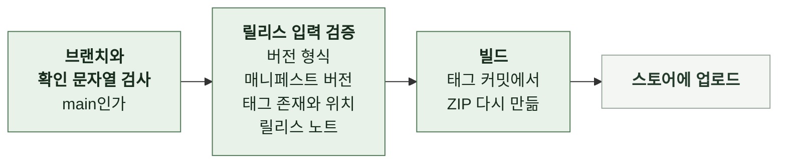
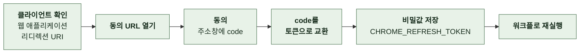

# 7-6 스토어 제출

이 문서는 GitHub Release를 만든 뒤 세 스토어에 업로드하기 위한 전제 조건과 절차, 자동 제출의 자격 증명, Chrome 제출 실패 대응, 배포 후 확인을 정한다.

릴리스 생성과 태그 순서는 릴리스에, 대상 브라우저와 배포 경로는 배포에, 스크린샷 규격은 스크린샷에 있다. ([7-5 릴리스](7-5-RELEASE.md), [7-4-1 배포 단위와 대상 브라우저](7-4-DEPLOYMENT.md#7-4-1-배포-단위와-대상-브라우저), [4-7 스크린샷](4-7-SCREENSHOT.md))

 

### 7-6-1 전제 조건

| 확인할 것 | 기준 |
| --- | --- |
| GitHub Release | 만들어져 있음 |
| 태그와 매니페스트 | 버전이 같음 |
| 릴리스 첨부 파일 | `linkhu-v{version}.zip`이 붙어 있음 |
| 릴리스 노트 | 버전별 릴리스 노트와 같음 |
| 스토어 계정 | Chrome, Firefox, Whale 관리자 계정에 접근할 수 있음 |
| 문구 | 스토어 등록 문구의 업데이트 절이 새 버전으로 병합되어 있음 |
| 권한 변경 | 매니페스트의 권한, 호스트 권한, Firefox 설정이 바뀌었는지 확인함. 권한이 늘면 세 스토어 모두에서 재심사 사유가 되고 기존 사용자에게 권한 승인 요구가 뜸 |
| 등록 정보 변경 | 스토어 설명, 스크린샷, 개인정보 처리 답변을 고쳐야 하는지 확인함 |

 

### 7-6-2 자동 제출의 공통 동작

Chrome과 Firefox는 메인테이너가 수동으로 실행하는 워크플로로 제출한다. 입력은 버전과 확인 문자열이다.

| 규칙 | 내용 |
| --- | --- |
| 확인 문자열 | 실수로 제출이 시작되는 것을 막음. 없애지 않음 |
| 버전 입력 | `v` 없는 숫자 세 부분. 다르면 `Invalid release version: {입력}`으로 실패 |
| 모의 실행 | `CHROME_DRY_RUN`, `FIREFOX_DRY_RUN`이 `true`면 입력과 파일 확인까지만 하고 올릴 대상을 출력한 뒤 끝냄 |
| ZIP | Release의 ZIP을 내려받지 않고 다시 빌드함. 재현 가능한 패키징이라 첨부 파일과 같음. Whale만 첨부 파일을 직접 씀 |
| 스토어 설명 | 바꾸지 않음. 업데이트 절은 각 스토어 관리 화면에 직접 붙여 넣음 |
| 오래 배포하지 않았을 때 | 릴리스 전에 배포 경로를 점검함. 자격 증명은 만료되거나 폐기될 수 있음 |
| 자격 증명 | 저장소 비밀값으로만 관리함. 파일과 값, 자리표시자에 채운 실제 값을 커밋하지 않음 |

 

### 7-6-3 Chrome Web Store

| 항목 | 값 |
| --- | --- |
| 실행 브랜치 | `main` |
| 확인 문자열 | `confirm_publish`에 `publish-chrome` |
| extension ID | `ihidkmjkpfphgljieecfcikljaopcldp` |
| 동작 | ZIP을 올리고 publish 요청까지 보내 심사에 제출함 |
| 확인 | Actions 로그의 upload, publish, fetchStatus 응답. Developer Dashboard에서 심사 제출 상태 |

| 저장소 비밀값 | 발급처 |
| --- | --- |
| `CHROME_CLIENT_ID` | Google Cloud Console의 OAuth 클라이언트 |
| `CHROME_CLIENT_SECRET` | Google Cloud Console의 OAuth 클라이언트 |
| `CHROME_REFRESH_TOKEN` | 7-6-4의 재발급 절차. `chromewebstore` 스코프 |
| `CHROME_PUBLISHER_ID` | Chrome Web Store Developer Dashboard |

 

### 7-6-4 Chrome 실패 대응

스토어 API 오류는 로그에 `Chrome publish failed: {단계} failed ({상태 코드}): {응답 본문}`으로 남는다. 단계는 `Chrome access token request`, `Chrome package upload`, `Chrome package publish`, `Chrome item status fetch`다. 마지막 단계의 실패는 이미 끝난 제출을 취소하지 않는다.

| 멈춘 단계 | 응답 | 원인 |
| --- | --- | --- |
| `Verify release input` | `Chrome publish workflow must be run from main.` | `main`이 아닌 브랜치에서 실행 |
| `Verify release input` | `confirm_publish must be publish-chrome.` | 확인 문자열 오류 |
| `Verify release input` | `Release tag ... points to ..., but the checked out commit is ...` | 태그가 `main`의 최신 커밋이 아님 |
| `Publish to Chrome Web Store` | `invalid_grant` | refresh token 문제 |
| `Publish to Chrome Web Store` | `NOT_UPDATEABLE` | 이전 제출이 심사 중 |

 

**1. refresh token 문제, `invalid_grant`**

| OAuth 동의 화면 게시 상태 | refresh token |
| --- | --- |
| 테스트 | 7일 뒤 만료 |
| 프로덕션 | 주기적으로 만료되지 않음 |

| 규칙 | 내용 |
| --- | --- |
| 먼저 볼 것 | Google Cloud Console OAuth 동의 화면의 게시 상태 항목. "확인되지 않은 앱" 경고로는 판별할 수 없음. 민감한 스코프라 프로덕션이어도 검증 전에는 경고가 나옴 |
| 경고 화면 | 개인용 앱은 검증 없이 **고급 → 안전하지 않은 페이지로 이동**으로 진행함 |
| 스코프 | `chromewebstore` 하나만. 클라우드 전체 권한을 강제하는 기본 자격 증명 로그인은 쓰지 않음 |

| 요청 | 값 |
| --- | --- |
| 리디렉션 URI | `https://developers.google.com/oauthplayground`. OAuth 클라이언트의 승인된 리디렉션 URI에 있어야 함 |
| 동의 URL | `https://accounts.google.com/o/oauth2/auth` |
| 동의 URL 쿼리 | `response_type=code`, `client_id`, `redirect_uri`, `scope=https://www.googleapis.com/auth/chromewebstore`, `access_type=offline`, `prompt=consent`. 뒤의 둘이 없으면 refresh token이 나오지 않음 |
| 토큰 교환 | `https://oauth2.googleapis.com/token`에 `POST`. `code`, `client_id`, `client_secret`, `redirect_uri`, `grant_type=authorization_code`. 형식은 Google의 [OAuth 2.0 for Web Server Applications](https://developers.google.com/identity/protocols/oauth2/web-server) |
| 성공 | 응답에 `refresh_token`이 있음 |

 

**2. 심사 중, `NOT_UPDATEABLE`**

Chrome Web Store는 심사 중인 항목에 새 패키지 업로드와 publish 요청을 막는다. 업로드 단계에서 막히면 `Chrome package upload`, publish 단계에서 막히면 `Chrome package publish`가 기록된다.

| 하지 않는 것 | 하는 것 |
| --- | --- |
| 토큰 재발급. 인증 문제가 아님 | Developer Dashboard에서 이전 제출의 심사 상태를 확인함 |
| 심사를 앞당기려는 시도 | 심사가 끝난 뒤 같은 입력으로 다시 실행함 |

 

### 7-6-5 Firefox Add-ons

| 항목 | 값 |
| --- | --- |
| 실행 브랜치 | `main` |
| 확인 문자열 | `confirm_publish`에 `publish-firefox` |
| AMO slug | `linkhu`. 매니페스트의 add-on ID와 다른 값 |
| locale | `ko` |
| license | `MIT` |
| 인증 | 요청마다 issuer와 secret으로 5분짜리 JWT를 새로 만들어 보냄 |
| 동작 | ZIP을 listed channel에 올리고 AMO 검사를 10초 간격으로 최대 10분 기다린 뒤 새 버전을 만듦 |
| 버전 노트 | 릴리스 노트에서 `### Internal` 절을 뺀 내용 |
| 확인 | Actions 로그의 upload, upload status, version create 응답. Developer Hub의 검사 결과와 제출 상태. 소스 코드 패키지 제출이 필요한 변경인지 |
| API 형식 | [AMO External API](https://mozilla.github.io/addons-server/topics/api/addons) |

| 저장소 비밀값 | 발급처 |
| --- | --- |
| `FIREFOX_JWT_ISSUER` | [AMO API credentials](https://addons.mozilla.org/en-US/developers/addon/api/key/)의 API key |
| `FIREFOX_JWT_SECRET` | 같은 화면의 API secret |

| 멈춘 단계 | 응답 | 원인 |
| --- | --- | --- |
| `Verify release input` | `Firefox publish workflow must be run from main.` | `main`이 아닌 브랜치에서 실행 |
| `Verify release input` | `confirm_publish must be publish-firefox.` | 확인 문자열 오류 |
| `Publish to Firefox Add-ons` | `Firefox upload validation failed: {검사 결과}` | AMO 검사 실패. 업로드는 남고 버전은 만들어지지 않음 |
| `Publish to Firefox Add-ons` | `Firefox upload validation timed out for {업로드 id}.` | 10분 안에 검사가 끝나지 않음. 업로드는 남고 버전은 만들어지지 않음 |

 

### 7-6-6 Whale Store

자동화가 없어 패키지 업로드까지 사람이 한다.

| 순서 | 할 일 |
| --- | --- |
| 1 | [Whale Store 개발자 센터](https://store.whale.naver.com/developers)에 로그인함. 등록 절차는 [Developer Center Distribution](https://whale.dev/distribution/) |
| 2 | My extensions에서 LinKHU 항목으로 감 |
| 3 | 새 패키지로 `linkhu-v{version}.zip`을 올림 |
| 4 | 필수 정보, 권한, 버전 설명(릴리스 노트)을 확인함 |
| 5 | 스토어 설명, 스크린샷, 카테고리 변경이 필요한지 확인함 |
| 6 | 제출 전 경고 메시지를 확인하고 심사를 요청함 |

 

### 7-6-7 배포 후 확인

| 확인할 것 | 기준 |
| --- | --- |
| 세 스토어에 보이는 버전 | 릴리스 태그와 같음 |
| 신규 설치와 업데이트 | 각 스토어에서 정상 동작함 |
| README 배지 | Chrome과 Firefox의 사용자 수와 버전 배지가 갱신됨 |
| 버전 일치 | GitHub Release, 스토어 버전, 매니페스트가 모두 같음 |
