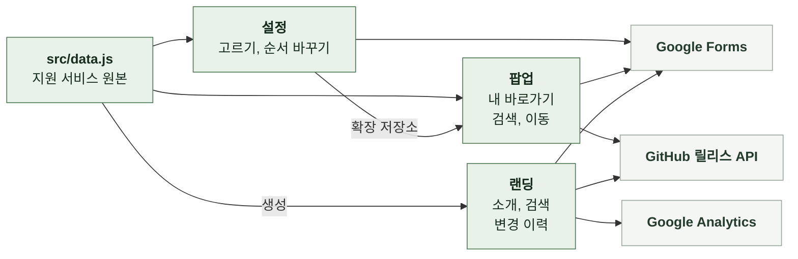

# LinKHU 스펙 문서

LinKHU는 경희대학교 주요 웹서비스 바로가기를 제공하는 브라우저 확장 프로그램이다.

이 폴더가 저장소의 문서 원본이다. 배경, 요구사항, 설계, 계약, 구현 규약, 운영을 번호 계층으로 담고, 결정의 배경과 대안은 [`DECISIONS.md`](DECISIONS.md)에 로그로 쌓는다. 이슈, 브랜치, 커밋, PR 절차는 [저장소 `AGENTS.md`](../../AGENTS.md)에 있다. 문서 목록과 상태, 작업별 참조, 코드와 스펙의 대응, 작성 규칙과 점검은 이 폴더의 [`AGENTS.md`](AGENTS.md)에 있다.

세 화면이 같은 데이터를 보고, 설정이 정한 순서를 팝업이 읽는다. 바깥 호출은 모두 부가 기능이라 실패해도 바로가기는 열린다.

 

## 스펙이 기준이다

이 문서만 보고 구현해도 지금과 같은 결과가 나와야 한다. 내부 변수 이름처럼 구현에서 정할 사항은 달라도 되지만, 기능, 화면 치수, 디자인 규칙, 처리 순서는 모두 여기에 있다.

| 원칙 | 내용 |
| --- | --- |
| 자연어로 적는다 | CSS 속성이나 함수 시그니처를 옮겨 적지 않는다. 무엇을 왜 정했는지 쓰고 결과값을 문장에 담는다 |
| 현재 정한 것만 적는다 | 검토 중인 방향, 후속 과제, 미정 사항은 이슈에 남긴다. 정해지고 구현된 것만 스펙에 들어온다. 결정되지 않은 것을 적어 두면 읽는 사람도 에이전트도 무엇을 따라야 할지 알 수 없다 |
| 이력을 적지 않는다 | 이전 동작, 바뀐 날짜, 경위는 결정 기록이나 PR로 보낸다 |
| 측정 가능하게 적는다 | "적절한 대비"가 아니라 "4.5:1 이상", "적당한 여백"이 아니라 "20px"처럼 확인할 수 있게 쓴다 |
| 같은 사실은 한 곳에서 정한다 | 아래 주제별 원본 표의 자리에만 쓰고, 다른 문서는 상단의 상세 위치 문장으로 가리킨다 |
| 영역 배치는 그림이 아니라 표로 적는다 | 선으로 그린 상자는 한글과 영문의 글자 폭이 다른 글꼴에서 세로 선이 어긋난다 |
| 규칙은 문장 그대로 쓴다 | `MUST`, `SHOULD` 같은 표기를 붙이지 않는다. "~한다"는 지키는 것이고, 재량이 있으면 "~해도 된다"로 적는다 |

 

## 번호는 층위다

번호가 작을수록 위다. 위가 바뀌면 아래를 전부 훑고, 아래 때문에 위를 고쳐야 한다면 위쪽 설계가 틀렸다는 신호로 보고 위가 왜 틀렸는지부터 본다. 리뷰도 위 문서부터 합의하고 아래로 내려간다.

| 층 | 정하는 것 |
| --- | --- |
| 1 | 제품이 무엇이고 어디까지가 범위인가 |
| 2 | 사용자와 운영자가 무엇을 할 수 있어야 하는가 |
| 3 | 제품이 다루는 단위와 각 화면이 보여주는 범위 |
| 4 | 그것을 어떤 화면, 조각, 상태로 만드는가 |
| 5 | 바깥과 무엇을 주고받기로 약속했는가 |
| 6 | 그 약속을 어떤 순서와 규약으로 구현하는가 |
| 7 | 실패, 검증, 배포를 어떻게 다루는가 |

카테고리를 하나 늘리는 변경은 3층이므로 4층(설정 화면 묶음, 필터 버튼), 6층(데이터 계약, 검증기), 7층(테스트)이 함께 움직인다. 카드 여백을 조정하는 변경은 4층이라 위로 올라가지 않는다.

파일명은 층에 문서가 하나면 `N`, 둘 이상이면 `N-M`이다. 문서가 늘어 쪼갤 때 `N-1`, `N-2`를 붙이고 바깥 링크를 함께 고친다. 이 층위를 정한 이유는 [결정 기록](DECISIONS.md)에 있다.

7-3 관측은 결번이다. 확장에는 텔레메트리, 분석 SDK, 원격 로그가 없어 관측 문서를 두지 않는다. 랜딩의 방문 측정은 [5-5 Google Analytics](5-CONTRACT.md#5-5-google-analytics)의 계약이다. 번호를 당기면 바깥 링크가 모두 깨지므로 비워 둔다.

 

## 주제별 원본

여러 문서에 흩어지기 쉬운 주제의 원본을 정한다. 절차와 규칙은 원본에만 쓰고 다른 문서는 원본을 가리킨다.

| 주제 | 원본 | 다른 문서의 역할 |
| --- | --- | --- |
| 이슈, 브랜치, 커밋, PR 절차 | [저장소 `AGENTS.md`](../../AGENTS.md) | 반복하지 않음 |
| 카테고리 목록과 서비스 수 | [3-2](3-INFORMATION-ARCHITECTURE.md#3-2-카테고리) | `6-2`는 값 형식만 |
| 화면별 노출 범위와 기본 목록 | [3-3](3-INFORMATION-ARCHITECTURE.md#3-3-화면별-범위), [3-4](3-INFORMATION-ARCHITECTURE.md#3-4-기본-목록) | `4-1`은 배치만 |
| 검색 대상과 순위 | [3-5](3-INFORMATION-ARCHITECTURE.md#3-5-검색이-다루는-범위) | `2-1`은 사용자가 겪는 결과만 |
| 데이터 스키마와 필드 규칙, 삭제 절차 | [6-2](6-2-DATA.md) | `2-2`는 운영자가 보장할 것만 |
| 검증과 생성 스크립트 순서 | [6-2-4](6-2-DATA.md#6-2-4-검증-파이프라인) | `7-4`는 CI에서 언제 도는지만 |
| 저장 키와 저장 시점 | [4-5](4-5-STATE.md) | `6-1`은 호출 순서만 |
| 토큰 원본과 이름 규칙 | [4-2-2](4-2-UI-SYSTEM.md#4-2-2-디자인-토큰-규칙) | 다른 문서는 참조만 |
| 색 토큰 값과 대비 실측 | [4-3-4](4-3-THEME.md#4-3-4-구현-방식과-토큰-계약), [4-3-5](4-3-THEME.md#4-3-5-대비-기준) | 다른 문서는 참조만 |
| 카드 폭 계산과 줄바꿈 표 | [4-1-4](4-1-LAYOUT.md#4-1-4-팝업-카드-이름) | `6-2`는 검증기 동작만 |
| 바깥 호출 계약 | [5](5-CONTRACT.md) | `7-1`은 실패 시 동작만 |
| 실패 동작과 문구 | [7-1](7-1-ERROR-HANDLING.md) | 다른 문서는 원본을 가리킴 |
| 서비스 아이콘 규칙 | [4-6](4-6-SERVICE-ICON.md) | `4-2-4`는 UI 아이콘만 |
| 스크린샷 규격 | [4-7](4-7-SCREENSHOT.md) | 다른 문서는 참조만 |
| 릴리스 실행 절차 | [7-5](7-5-RELEASE.md) | `2-2`는 보장할 것, `7-4`는 자동화 범위 |
| 스토어 제출 절차 | [7-6](7-6-STORE.md) | `7-4`는 경로와 자동화 범위 |
| 수동 검증 항목 | [7-2-3](7-2-TEST-CASES.md#7-2-3-수동-검증-항목) | 저장소 `AGENTS.md`의 수동 검증 기준을 화면 단위로 구체화 |
| 결정의 배경과 대안 | [DECISIONS](DECISIONS.md) | 다른 문서는 결과만 씀 |

 

## 변경 원칙

| 순서 | 원칙 |
| --- | --- |
| 1 | 스펙이 먼저다. 구현 PR은 관련 스펙을 먼저 고치거나 스펙과 구현을 같은 PR에서 함께 바꾼다 |
| 2 | 위 번호를 고쳤으면 아래를 전부 훑는다 |
| 3 | 코드를 바꾸면 [대응표](AGENTS.md#3-명세와-코드의-대응)에서 짝지어진 문서를 같은 PR에서 고친다 |
| 4 | 다른 설계 방향을 놓고 고른 판단은 [`DECISIONS.md`](DECISIONS.md)에 표 하나로 덧붙이고, 스펙에는 결과만 쓴다 |

문서와 코드가 어긋나면 어느 쪽이 맞는지 먼저 가린다.

| 어긋난 것 | 처리 |
| --- | --- |
| 값, 구조, 경로 같은 사실 서술이 틀렸다 | 스펙을 고친다 |
| 코드가 스펙의 계약이나 규칙을 어겼다 | 스펙을 그대로 두고 코드를 고칠 이슈를 만든다. 스펙을 코드에 맞추면 같은 문서의 다른 규칙과 모순이 생긴다 |
| 코드의 동작이 스펙의 계약보다 낫다 | 스펙을 코드에 맞춘다 |
| 어느 쪽이 맞는지 정책 결정이 필요하다 | 스펙에는 현재 동작을 적고 결정할 이슈를 만든다 |
